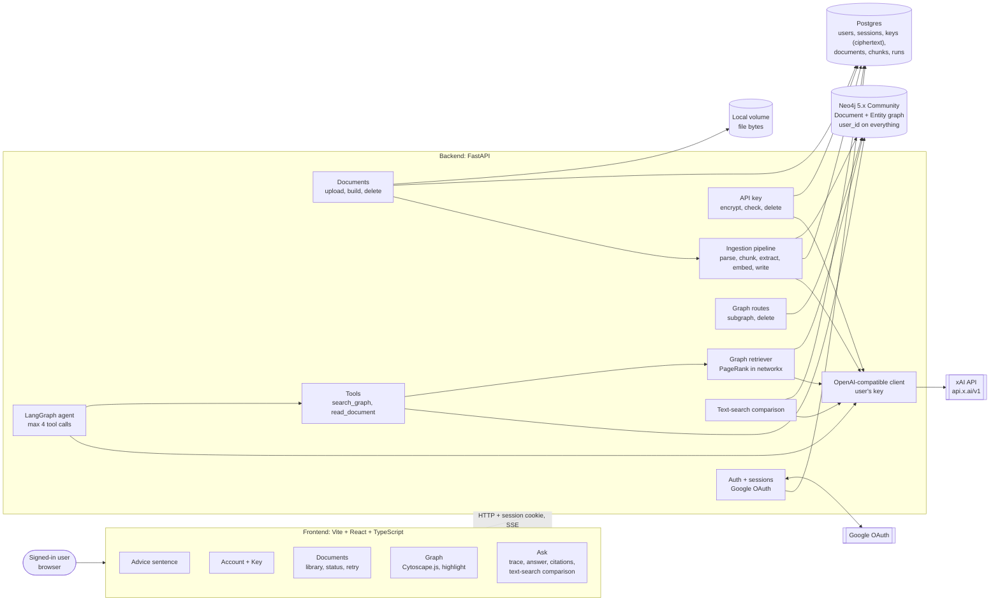
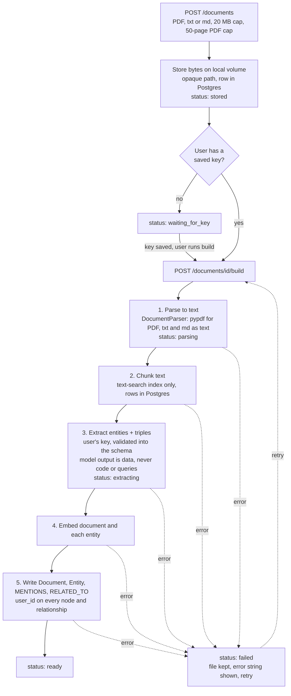
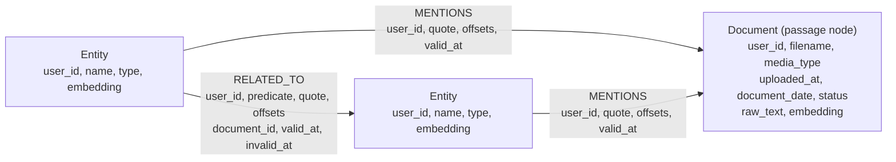
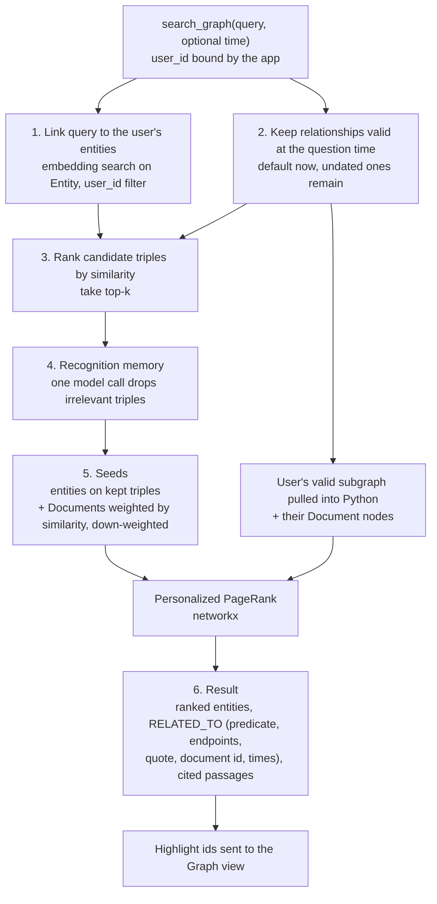
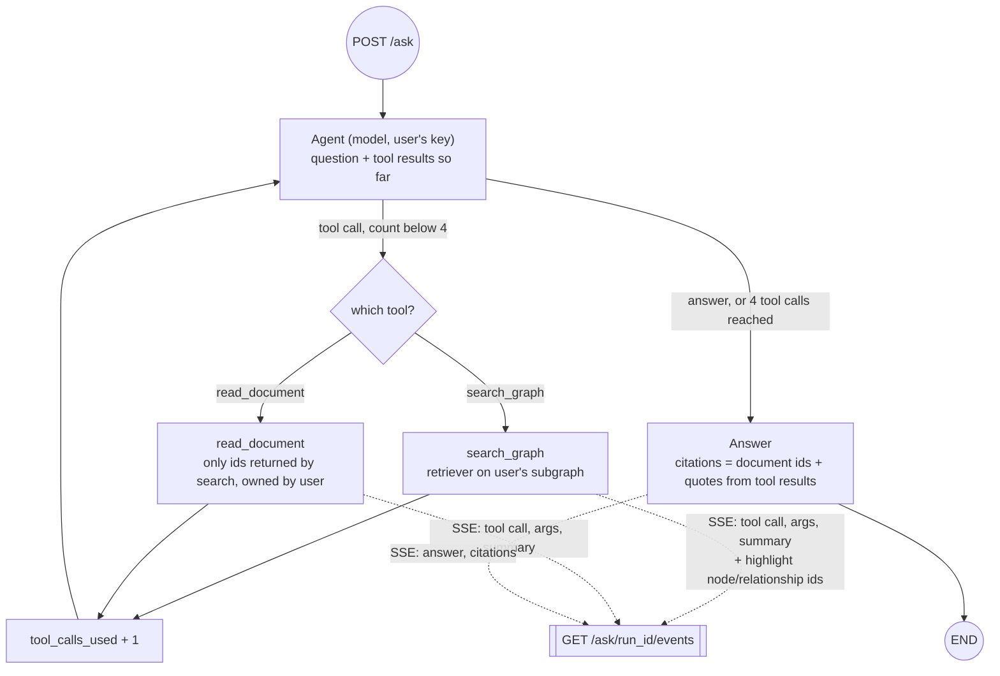

# Architecture (scaffold)

> **Status:** scaffold. The decisions below are **settled** by
> [`problem-statement.md`](problem-statement.md) unless listed under
> [Open items](#14-open-items). Only `GET /health` and a placeholder page run today;
> everything else is a documented stub.

Contents

1. [Product in one paragraph](#1-product-in-one-paragraph)
2. [Settled decisions](#2-settled-decisions)
3. [System overview](#3-system-overview)
4. [Accounts, sessions and API keys](#4-accounts-sessions-and-api-keys)
5. [Documents and the ingestion pipeline](#5-documents-and-the-ingestion-pipeline)
6. [Knowledge graph](#6-knowledge-graph)
7. [Retriever](#7-retriever)
8. [The agent](#8-the-agent)
9. [Text-search comparison](#9-text-search-comparison)
10. [Interface](#10-interface)
11. [HTTP surface](#11-http-surface)
12. [Tenancy and secrets](#12-tenancy-and-secrets)
13. [Repository layout](#13-repository-layout)
14. [Open items](#14-open-items)

Rendered PNGs of every diagram live in [`docs/diagrams/`](diagrams/).

---

## 1. Product in one paragraph

A person signs in with Google, uploads their own PDF, `.txt` and `.md` files, and gets a
knowledge graph of those files that they can click through with no question typed. They
save their own xAI API key; with it, a **fixed ingestion pipeline** extracts entities and
triples into **their** Neo4j graph, and **one tool-using agent** answers questions by
calling a graph retriever (`search_graph`) and a passage reader (`read_document`). The
screen shows each tool call, lights up the subgraph that came back, and cites the
passages used. A separate on-demand **text-search comparison** answers the same question
from text chunks only. The product is free; the model bill is the user's key.

## 2. Settled decisions

| Topic | Decision | ADR |
|---|---|---|
| Product | Personal live graph over the user's files, plus one visible agent | spec |
| Auth | Google OAuth authorization-code flow, scopes `openid email profile`, server sessions | [0008](decisions/0008-google-oauth-sessions.md) |
| App data | Postgres: accounts, sessions, document rows, ciphertext keys, chunk rows | [0009](decisions/0009-postgres-app-data.md) |
| Cache | None in this version | [0010](decisions/0010-redis-dropped-this-version.md) |
| Graph store | Neo4j 5.x Community (`neo4j:5.26-community`), `user_id` on every element | [0011](decisions/0011-neo4j-per-user-graph.md) |
| Retrieval | HippoRAG-2-inspired, time-aware Personalized PageRank; PageRank in `networkx` | [0012](decisions/0012-retrieval-graph-ppr.md) |
| Orchestration | LangGraph, one agent, tools `search_graph` and `read_document`, max 4 tool calls | [0013](decisions/0013-single-langgraph-agent.md) |
| Model host | `https://api.x.ai/v1`, OpenAI-compatible, one client, the user's own key | [0014](decisions/0014-user-xai-key.md) |
| Baseline | On-demand chunk search, not an agent | spec |
| Frontend | Existing Vite + React + TypeScript app, Cytoscape.js for the graph | [0005](decisions/0005-frontend-framework.md) |
| File bytes | Local volume, opaque stored paths | spec |
| PDF | `DocumentParser` interface, pypdf first | spec |
| Time | Optional document date; undated statements stay valid; no automatic invalidation | spec |
| Price | Free; no billing, teams or sharing | spec |

## 3. System overview



## 4. Accounts, sessions and API keys

* **Google only.** Authorization-code flow with scopes `openid`, `email`, `profile` (no
  Gmail, no Drive). The OAuth `state` is stored server-side for the round trip. The
  server verifies the ID token (`iss`, `aud`, `exp`), creates a session row in Postgres,
  and sets an `httpOnly`, `Secure`, `SameSite=Lax` cookie holding a random session id.
  Logout deletes the session. No passwords, second provider, guest mode, or fake user.
* **Environment:** `GOOGLE_CLIENT_ID`, `GOOGLE_CLIENT_SECRET`, `GOOGLE_REDIRECT_URI`
  (localhost for development), `SESSION_SECRET`.
* **The user's xAI key** is stored as ciphertext only, encrypted with
  `KEY_ENCRYPTION_SECRET`. Never logged, never in the frontend bundle, never returned in
  full; the client may see "a key is saved" and the last four characters. "Check key"
  makes one cheap authenticated call. Deleting the key stops new model calls and keeps
  the graph.
* **One client:** OpenAI-compatible, base URL `https://api.x.ai/v1` (fixed in this
  version, no override), model ids from `JEWEL_LLM_MODEL` / `JEWEL_EMBEDDING_MODEL`.
  Extraction, embeddings, recognition filter, agent and comparison all use the signed-in
  user's key. A developer key in the environment is for automated tests only.

## 5. Documents and the ingestion pipeline

A document is one file: owner, original filename, media type, upload time, optional
document date, extracted text, status, error string. Caps: 20 MB per file, 50 PDF pages;
over-cap uploads fail and are not stored. Uploads are accepted with or without a key;
building waits for a key and the UI says building spends it.

The pipeline is **fixed**: the same steps in the same order for one document of one user.
It is not an agent.



Extraction schema: Entity `name` and `type` (`person`, `organization`, `place`, `concept`,
`other`); Triple `subject`, `object` (entity names), `predicate` (short phrase, stored as a
property), `quote` (span copied from the text), character offsets when returned.
Entity identity within one user: case-fold the name and reuse on exact match; never merge
across users.

The document date is optional: set by the user or taken from a single obvious date in the
file. The product does not invent a date.

## 6. Knowledge graph

One Neo4j database. **Every node and relationship carries `user_id`**, and every read and
write is constrained to the signed-in user. A missing predicate is a defect.



* `valid_at` is the document date when there is one, otherwise null (undated, treated
  as valid). `invalid_at` is null unless the user deletes or a later write explicitly
  closes the relationship. Nothing closes edges automatically.
* **Valid at `t`** (single predicate, used by retrieval):

  ```cypher
  (r.valid_at IS NULL OR r.valid_at <= $t)
  AND (r.invalid_at IS NULL OR r.invalid_at > $t)
  ```

  The spec writes this without the first pair of parentheses; because `AND` binds more
  tightly than `OR`, the parenthesised form above is the reading that matches the stated
  intent ("undated relationships stay in the valid set", closed ones drop out).
* **Provenance:** every `MENTIONS` and `RELATED_TO` points at its document and quote; the
  graph view and the answer both show that quote.
* **Embeddings:** `LIST<FLOAT>` properties with a Neo4j vector index; dimension from the
  embedding model settings. The Enterprise `VECTOR` property type is not required.
* **Deletes:** the user may delete an entity or a relationship. Deleting a document
  removes its `MENTIONS`, the `RELATED_TO` rows whose `document_id` is that document, then
  entities with no remaining `MENTIONS` for that user.

## 7. Retriever

`search_graph` runs this pipeline on **that user's** subgraph only. The `user_id`
constraint is applied before similarity search and before the subgraph is pulled into
Python. PageRank runs in `networkx`; Neo4j Graph Data Science is not used.



The recognition-memory step filters candidates; it does not answer the question.

## 8. The agent

One agent. LangGraph is the runtime: a tool-using loop, not a fixed `retrieve -> answer`
function and not a supervisor.

| Tool | Behaviour |
|---|---|
| `search_graph` | Runs the retriever. Args: query written by the agent, optional time. Returns entities, relationships, document passages. |
| `read_document` | Args: a document id returned by `search_graph`, optional span. Returns text. Refuses ids search did not return and ids the user does not own. |



* **Cap:** after at most **4** tool calls the agent must answer.
* **Isolation:** the agent never receives a Neo4j session, a query-string parameter, or the
  API key; the application binds the user id and the key outside the model.
* **Trace:** streamed with Server-Sent Events in order: tool name, arguments, a short
  result summary (counts and document names), highlight ids after each `search_graph`,
  then the answer and citations, or an error. The UI drops a citation that does not match
  a tool result, and keeps a highlight until the next search or until the user clears it.
* **State:** question, user id, optional time, tool trace, tool-call count, document ids
  returned by search, citations, answer.

## 9. Text-search comparison

`compare_text` (`POST /ask/{run_id}/compare`) is not a tool and not an agent: the same
question, model and embedding model; the user's chunks top-k by cosine similarity; one
answer. It ignores relationships and time. It is opened from an existing answer, and the
panel shows that answer and the chunks it used, so a reader can see when the graph path
and the text path disagree.

## 10. Interface

One page after sign-in with three regions named **Documents**, **Graph**, **Ask**, plus
**Key** and **Account**, and one plain sentence: answers quote the user's documents and
are not medical, legal, or financial advice. Signed-out visitors see sign-in and that
sentence, never a graph. The trace uses the names "Search graph" and "Read document".
Internal method names (the retriever's research lineage, the ranking algorithm, the
database query language) do not appear in the interface.

| Region | Contents |
|---|---|
| Documents | Filename, upload time, status, error, retry, open extracted text; choosing a document filters the graph; empty copy asks for an upload (no sample corpus) |
| Graph | Cytoscape.js; pan/zoom; labelled nodes; edges labelled with the predicate; click node: name, type, quote, source file; click edge: predicate, quote, source file, times; agent highlight; delete |
| Ask | Question box, disabled with an explanation when no key or no `ready` document; trace, answer, citations that jump to document text, comparison control |
| Key | Paste (empty when a key is saved), check, delete |
| Account | Google name and email, sign out |

The scaffold page shows the sentence, an inert sign-in button, and empty Documents,
Graph and Ask regions. Cytoscape.js is added with the graph implementation.

## 11. HTTP surface

Session required on every route except health and the Google start/callback routes. Only
`/health` is mounted in this scaffold.

| Route | Purpose | Module |
|---|---|---|
| `GET /health` | Process up | `api/routes/health.py` (mounted) |
| `GET /auth/google`, `GET /auth/google/callback`, `POST /auth/logout`, `GET /me` | Sign-in, cookie, sign-out, profile + key status | `api/routes/auth.py` |
| `PUT /me/api-key`, `DELETE /me/api-key`, `POST /me/api-key/check` | Store, delete, check key | `api/routes/keys.py` |
| `POST /documents`, `GET /documents`, `GET /documents/{id}`, `POST /documents/{id}/build`, `DELETE /documents/{id}` | Library and ingestion | `api/routes/documents.py` |
| `GET /graph`, `DELETE /graph/entities/{id}`, `DELETE /graph/relationships/{id}` | Subgraph and deletes | `api/routes/graph.py` |
| `POST /ask`, `GET /ask/{run_id}/events`, `POST /ask/{run_id}/compare` | Agent run, SSE trace, comparison | `api/routes/ask.py` |

## 12. Tenancy and secrets

* Every document, chunk, node, relationship, key and question trace is stored against the
  user id. Graph queries take the user id from the session; a client-sent id never
  replaces it.
* Keys at rest are ciphertext; session cookies are `httpOnly`; logs omit document text
  and keys. Files live on a local volume at opaque stored paths.
* Planned tests (later passes, no live services): user A cannot read or delete user B's
  document, graph neighbourhood, or key status; `read_document` rejects another user's
  document id; the retriever's candidate set contains no other user's entities. The
  warehouse-key fixture ([`data/fixtures/README.md`](../data/fixtures/README.md)) will
  show the graph path reaching a document the chunk search misses.

## 13. Repository layout

```text
jewel/
├── backend/                 FastAPI, Python 3.11+, uv
│   ├── src/jewel/
│   │   ├── api/             app factory; routes: health (mounted), auth, keys, documents, graph, ask (stubs)
│   │   ├── auth/            google, sessions, api_keys
│   │   ├── db/              postgres
│   │   ├── documents/       models (status, limits), storage (local volume)
│   │   ├── ingestion/       pipeline, chunking
│   │   ├── parsing/         DocumentParser; pdf, text (txt + md)
│   │   ├── kg/              schema, neo4j_store, temporal, extraction
│   │   ├── retrieval/       hippo/ (linking, recognition, ppr, pipeline), baseline_rag
│   │   ├── agents/          graph, state, tools
│   │   ├── llm/             model interfaces (one OpenAI-compatible client later)
│   │   └── config.py
│   └── tests/
├── frontend/                Vite + React + TypeScript placeholder page
├── infra/docker-compose.yml neo4j, postgres, backend, frontend
├── data/fixtures/           warehouse-key test fixture (tests only)
└── docs/                    spec, this document, ADRs, diagrams, open questions
```

## 14. Open items

Exactly the three the spec leaves open; see [`open-questions.md`](open-questions.md).
