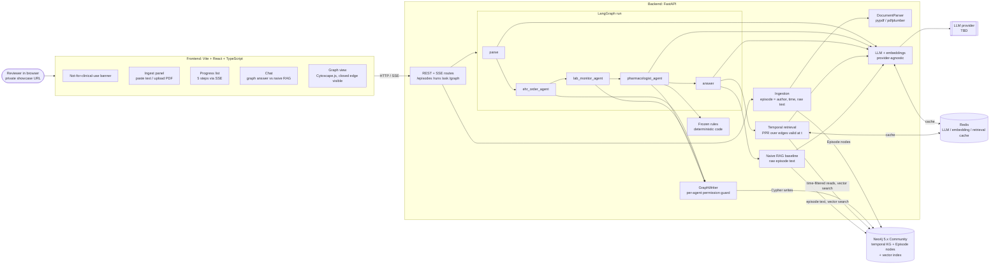
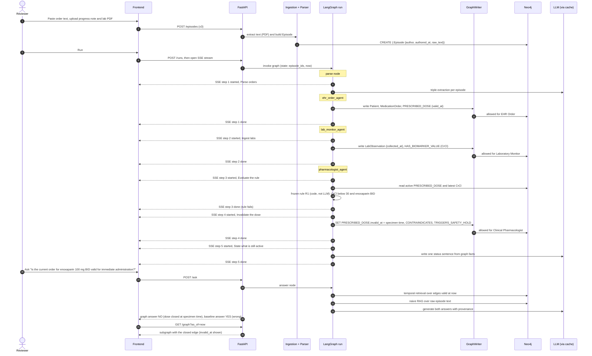
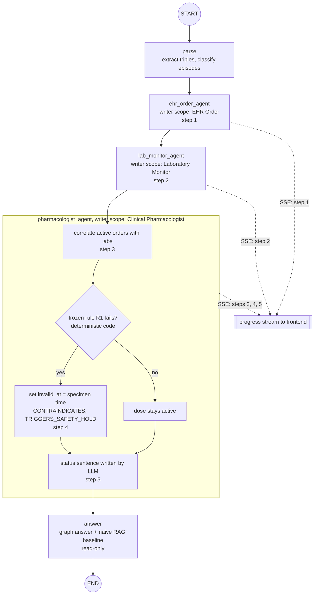
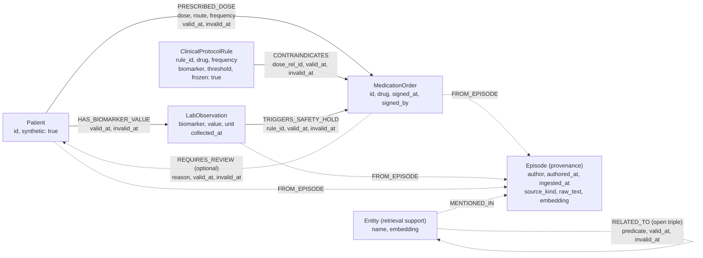
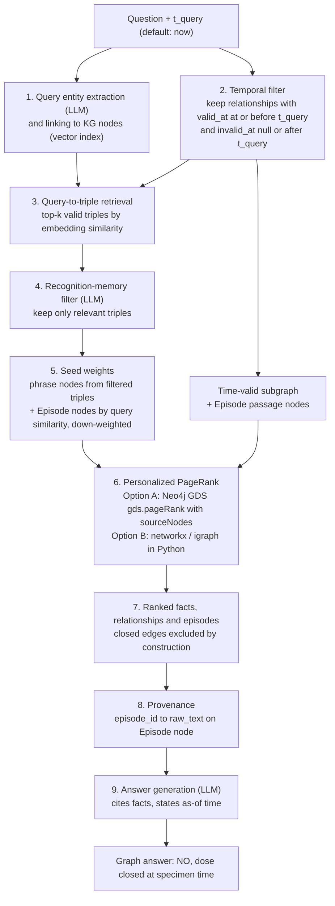

# Architecture proposal (step 1)

> **Status:** for review. Decisions marked **Accepted** were made by Srikar; everything
> marked **Proposed** is a suggestion open for review. Nothing here is implemented yet
> beyond a `/health` route and documented stubs.
>
> **Not for clinical use.** Synthetic patient, private showcase.

Contents

1. [Goal in one paragraph](#1-goal-in-one-paragraph)
2. [Decision summary](#2-decision-summary)
3. [System overview](#3-system-overview)
4. [LangGraph orchestration (Proposed, for review)](#4-langgraph-orchestration-proposed-for-review)
5. [Temporal knowledge graph in Neo4j](#5-temporal-knowledge-graph-in-neo4j)
6. [Agent write permissions](#6-agent-write-permissions)
7. [Retrieval (Proposed: Zeus's suggestion, pending user input)](#7-retrieval-proposed-zeuss-suggestion-pending-user-input)
8. [Naive RAG baseline (the proof)](#8-naive-rag-baseline-the-proof)
9. [Caching](#9-caching)
10. [Repository layout](#10-repository-layout)
11. [What is deliberately not decided yet](#11-what-is-deliberately-not-decided-yet)

Rendered PNGs of every diagram live in [`docs/diagrams/`](diagrams/).

---

## 1. Goal in one paragraph

Pasted text and uploaded documents become **episodes** in a **temporal knowledge graph**.
Three **role-restricted agents** (EHR Order, Laboratory Monitor, Clinical Pharmacologist)
run in order and may write only their own node and relationship kinds. A **frozen rule**
(therapeutic enoxaparin twice daily is not valid when creatinine clearance is below
30 mL/min) closes the `PRESCRIBED_DOSE` relationship by setting `invalid_at` to the
specimen time. The question *"Is the current order for enoxaparin 100 mg twice daily valid
for immediate administration?"* is answered from relationships **valid at "now"** (answer:
no). A **naive RAG** over the raw notes answers the same question wrongly, because the lab
never names the drug. Full spec: [`problem-statement.md`](problem-statement.md).

## 2. Decision summary

| Area | Choice | Status | Alternatives considered | ADR |
|---|---|---|---|---|
| Graph store | **Neo4j 5.x Community** (temporal properties on relationships, native vector index) | **Accepted** | Postgres + pgvector, Apache AGE | [0002](decisions/0002-graph-store-neo4j.md) |
| Cache | **Redis** (official image, `redis-py`) | **Accepted** | Valkey (drop-in fork) | [0003](decisions/0003-cache-redis.md) |
| Retrieval | HippoRAG-2-inspired, time-filtered Personalized PageRank | **Proposed** (Zeus's suggestion, pending user input) | HippoRAG 1, LightRAG-style dual-level, Think-on-Graph, temporal PPR variants | [0004](decisions/0004-retrieval-approach.md) |
| Frontend | Vite + React + TypeScript, Cytoscape.js graph view | Proposed | Next.js; react-force-graph | [0005](decisions/0005-frontend-framework.md) |
| Deployment | docker-compose locally; hosting undecided | Proposed | Render / Railway / Fly.io + Vercel / Netlify; single VM | [0006](decisions/0006-deployment.md) |
| Orchestration | LangGraph, fixed sequential graph, graph-writer permission layer | Proposed, for review | LangGraph supervisor; plain Python pipeline | [0007](decisions/0007-langgraph-orchestration.md) |
| Backend | Python 3.11+, FastAPI, Pydantic | Given by user | - | - |
| LLM | Provider-agnostic `ChatModel` / `EmbeddingModel` interfaces, configured via env | Proposed (provider open) | - | [open questions](open-questions.md) |
| Document parsing | `DocumentParser` interface; pypdf or pdfplumber first | Proposed | docling | [open questions](open-questions.md) |

## 3. System overview



### End-to-end sequence (ingestion to answer, with the five progress steps)



## 4. LangGraph orchestration (Proposed, for review)

This section is the proposal the user asked to review. ADR:
[0007](decisions/0007-langgraph-orchestration.md).

### 4.1 State schema

One typed state object (Pydantic model or `TypedDict`) flows through the graph:

| Field | Type (sketch) | Written by | Purpose |
|---|---|---|---|
| `run_id` | `str` | API | Correlates SSE events, logs, cache keys |
| `patient_id` | `str` | `ehr_order_agent` | The single synthetic patient |
| `now` | `datetime` | API | Reference time for "valid now" queries (defaults to wall clock; can be pinned for a reproducible demo) |
| `episode_ids` | `list[str]` | API | Episodes already persisted as `:Episode` nodes |
| `parsed` | `dict[episode_id, ParsedEpisode]` | `parse` | Clean text, detected kind (order / note / lab), extracted triples |
| `order_refs` | `list[str]` | `ehr_order_agent` | Ids of MedicationOrder and PRESCRIBED_DOSE written |
| `lab_refs` | `list[str]` | `lab_monitor_agent` | Ids of LabObservation / HAS_BIOMARKER_VALUE written |
| `rule_verdicts` | `list[RuleVerdict]` | `pharmacologist_agent` | Deterministic output of `jewel.rules` (rule id, pass/fail, specimen time, inputs) |
| `closed_edges` | `list[str]` | `pharmacologist_agent` | PRESCRIBED_DOSE relationships whose `invalid_at` was set |
| `status_sentence` | `str` | `pharmacologist_agent` | The one sentence the LLM writes; never a decision |
| `question`, `graph_answer`, `baseline_answer` | `str` / `Answer` | `answer` | Side-by-side answers with provenance |
| `progress` | `list[ProgressEvent]` | every node | (step, status, timestamp); relayed to the UI |
| `write_log` | `list[WriteAttempt]` | `GraphWriter` | Every attempted write: agent, op, kind, allowed/denied |

### 4.2 Nodes

| Node | Role | Reads | Writes (through `GraphWriter`) | Progress step(s) |
|---|---|---|---|---|
| `parse` | Load episodes, LLM triple extraction, classify episode kind | `:Episode` | none to the clinical schema (retrieval-support `:Entity` nodes only, if we keep them) | 1 started |
| `ehr_order_agent` | Turn the order episode into typed facts | parsed order | Patient, MedicationOrder, opening PRESCRIBED_DOSE | 1 done |
| `lab_monitor_agent` | Turn the lab episode into typed facts | parsed lab | LabObservation, HAS_BIOMARKER_VALUE (incl. CrCl) | 2 |
| `pharmacologist_agent` | Correlate active orders with labs, apply frozen rule, close dose | graph valid at `now` | CONTRAINDICATES, TRIGGERS_SAFETY_HOLD, REQUIRES_REVIEW, `invalid_at` on the failing dose | 3, 4, 5 |
| `answer` | Graph answer and naive RAG baseline | graph + episodes | none (read-only) | after step 5 |

### 4.3 Edges and control flow



The rule branch lives **inside** `pharmacologist_agent` (plain Python), not as a separate
LLM-routed edge, so the only conditional logic is deterministic.

**Recommendation: fixed sequential graph** (`START -> parse -> ehr -> lab -> pharm ->
answer -> END`).

| Option | Pros | Cons |
|---|---|---|
| **Fixed sequence (recommended)** | Matches the spec ("three agents run in order"); deterministic, reproducible demo; progress steps map 1:1 to nodes; easy to test | Less "agentic" looking; adding agents means editing the graph |
| Supervisor (LLM routes between agents) | Flexible, shows dynamic delegation | Non-deterministic order; an LLM could skip or repeat an agent; harder to guarantee the five steps; more tokens |
| Plain Python pipeline (no LangGraph) | Simplest | Loses LangGraph streaming, checkpointing, and the user's stack preference |

### 4.4 Emitting the five progress steps

* Each node appends `ProgressEvent(step, status, ts)` to state and also emits a custom
  stream event (LangGraph streaming, e.g. `stream_mode` with custom/update events).
* `POST /runs` starts the graph in the background and returns a `run_id`;
  `GET /runs/{run_id}/events` is a **Server-Sent Events** stream that relays those events
  to the frontend, which renders the five-step list.
* SSE is proposed over WebSockets because traffic is one-way and it works through most
  proxies/PaaS without extra setup.

### 4.5 Enforcing per-agent write permissions (graph-writer layer)

* Agents never receive a Neo4j driver or session. Each agent node gets a
  `GraphWriter(agent=AgentRole.X)` whose methods (`create_node`, `open_edge`,
  `close_edge`, ...) check `(agent, operation, kind)` against the matrix in
  [section 6](#6-agent-write-permissions) **before** building parameterised Cypher.
* A violation raises `PermissionError`, is recorded in `write_log`, and fails the node
  loudly (no silent drop). Tests will assert that, for example, the Laboratory Monitor
  cannot touch `PRESCRIBED_DOSE`.
* `close_edge` for `PRESCRIBED_DOSE` additionally requires a failing `RuleVerdict` from
  `jewel.rules` whose `invalid_at` equals the lab's `collected_at`: the pharmacologist
  cannot close a dose on its own judgement or invent a threshold.
* LLM output is only ever *data* to validate (parsed into Pydantic models), never code
  or Cypher that is executed.
* Optional defence in depth (open question): a separate Neo4j user per agent is not
  available in Community Edition (fine-grained RBAC is an Enterprise feature), so the
  guard lives in application code.

## 5. Temporal knowledge graph in Neo4j

**Storage decision (Accepted):** Neo4j 5.x Community. Clinical kinds from the spec become
native labels and relationship types. Time is stored as properties:

* `valid_at` / `invalid_at` (Neo4j `DATETIME`) on **every clinical relationship**, so
  one predicate works everywhere.
* `collected_at` on `:LabObservation` (specimen time).
* `recorded_at` and `written_by` (agent) on every write (transaction time and audit),
  which makes the graph effectively **bitemporal**: *when it was true* vs *when we
  learned it*.
* `episode_id` on every node/relationship pointing to the `:Episode` it came from.

**"Valid now"** (single source of truth, `jewel.kg.temporal`):

```cypher
MATCH (a)-[r]->(b)
WHERE r.valid_at <= $t AND (r.invalid_at IS NULL OR r.invalid_at > $t)
```

**Provenance:** raw episode text is stored on `:Episode` nodes inside Neo4j, so every hop
the UI shows can be checked against the original text.

**Vectors:** embeddings are stored as `LIST<FLOAT>` properties on `:Entity` and `:Episode`
nodes and indexed with Neo4j's native vector index (`CREATE VECTOR INDEX ...`,
queried with `db.index.vector.queryNodes`). Community Edition can index `LIST`
properties; the newer native `VECTOR` property type needs Enterprise block format, which
we do not need.



Notes on the schema (all **Proposed**; endpoints are open questions):

* Every clinical relationship also carries `recorded_at`, `written_by`, `episode_id`
  (omitted from the diagram for readability).
* Neo4j relationships cannot point at other relationships, so `CONTRAINDICATES` targets
  the `MedicationOrder` and records the id of the dose relationship it fires on.
* Dashed items are retrieval-support structure (HippoRAG-style phrase and passage nodes),
  not part of the clinical schema in the spec.

Worked example of the demo state after the run (times illustrative):

| Relationship | `valid_at` | `invalid_at` | Valid at "now"? |
|---|---|---|---|
| `(Patient)-[:PRESCRIBED_DOSE {100 mg, SC, BID}]->(enoxaparin order)` | order signed time | **lab specimen time** | **No** |
| `(Patient)-[:HAS_BIOMARKER_VALUE]->(CrCl below 30 mL/min)` | specimen time | null | Yes |
| `(rule R1)-[:CONTRAINDICATES]->(enoxaparin order)` | specimen time | null | Yes |
| `(CrCl lab)-[:TRIGGERS_SAFETY_HOLD]->(enoxaparin order)` | specimen time | null | Yes |

## 6. Agent write permissions

Enforced in code by `GraphWriter` (see 4.5), from the spec's agent table.
C = create, S = set/close (`invalid_at`), - = denied.

| Kind | EHR Order | Laboratory Monitor | Clinical Pharmacologist |
|---|---|---|---|
| `Patient` (node) | C | - | - |
| `MedicationOrder` (node) | C | - | - |
| `PRESCRIBED_DOSE` open (`valid_at`) | C | - | - |
| `PRESCRIBED_DOSE` close (`invalid_at`) | - | - | S, only with a failing frozen-rule verdict, `invalid_at` = specimen time |
| `PRESCRIBED_DOSE` change dose/route/frequency | - | - | - |
| `LabObservation` (node, `collected_at`) | - | C | - |
| `HAS_BIOMARKER_VALUE` (incl. creatinine clearance) | - | C | - |
| `ClinicalProtocolRule` (node) | - | - | - (seeded from code at startup; frozen) |
| `CONTRAINDICATES` | - | - | C |
| `TRIGGERS_SAFETY_HOLD` | - | - | C |
| `REQUIRES_REVIEW` | - | - | C (optional) |
| New order / replacement prescription | - | - | - |
| Read labs / apply rules | - (may not read labs) | - | yes |

## 7. Retrieval (Proposed: Zeus's suggestion, pending user input)

> **Status: Proposed.** This is Zeus's suggestion, **pending user input**; Srikar plans to
> bring his own ideas on dynamic retrievers. Constraints from the user: dynamic,
> query-time, **no training, no GNNs**, and must respect temporal validity. ADR:
> [0004](decisions/0004-retrieval-approach.md).

KG construction via LLM `(e1, r, e2)` triple extraction is standard; retrieval is where
the interesting work is. The suggestion adapts **HippoRAG 2** (Gutiérrez et al.,
*From RAG to Memory: Non-Parametric Continual Learning for Large Language Models*,
ICML 2025, arXiv:2502.14802): an open KG of phrase nodes plus **passage nodes**, query-to-
triple embedding retrieval, an LLM **recognition-memory** filter over candidate triples,
and **Personalized PageRank** seeded by the filtered phrase nodes plus down-weighted
passage nodes. Our change: every step runs on the subgraph **valid at `t_query`**.



**Why this should beat naive RAG on the demo:** the lab episode never names the drug, so
text similarity to the question does not find it. In the graph, the question links to the
enoxaparin order; the active facts around it (`CONTRAINDICATES`, `TRIGGERS_SAFETY_HOLD`,
the lab) are reachable in one or two hops, and the closed `PRESCRIBED_DOSE` is simply
absent from the time-valid subgraph.

**Open sub-question: where PPR runs.**

| Option | How | Pros | Cons |
|---|---|---|---|
| A. Neo4j Graph Data Science (GDS) | Project only time-valid relationships (Cypher projection with the temporal predicate) then `gds.pageRank.stream(..., {sourceNodes: [[node, bias], ...]})` | Stays in the database; biased personalization is built in | Extra plugin; GDS Community Edition is free but capped at 4 CPU cores; the Neo4j-distributed jar includes closed-source components (the open sources build as GPLv3 "OpenGDS"); per-query projection overhead; managed-host support to verify |
| B. Python (networkx / python-igraph) | Pull the time-valid subgraph, run `pagerank(personalization=...)` | Simple, transparent, trivially testable, no plugin | Data transfer per query (irrelevant at demo size); not for large graphs |

For a three-episode demo either works; B is simplest to start, A is the path if the graph grows.

### Other dynamic, training-free, query-time options worth considering

Listed for the user's review; none needs a GNN or training.

* **HippoRAG (v1) vs HippoRAG 2.** HippoRAG (Gutiérrez et al., NeurIPS 2024,
  arXiv:2405.14831) seeds PPR from query entities over an entity-only graph; HippoRAG 2
  adds passage nodes and the LLM recognition-memory triple filter, which the paper reports
  recovers factual-QA performance that v1 lost relative to dense retrieval.
* **LightRAG-style dual-level retrieval** (Guo et al., arXiv:2410.05779): extracts entities
  and relations into a graph and retrieves at a low level (specific entities and their
  relations) and a high level (broader themes/keywords), combining graph structure with
  vector search; supports incremental updates.
* **Think-on-Graph** (Sun et al., ICLR 2024): an LLM agent performs iterative beam search
  over the KG, expanding and pruning relations/entities to find reasoning paths;
  training-free. Could be made temporal by only allowing expansion along relationships
  valid at `t_query`. Costs more LLM calls per query.
* **Temporal-aware propagation/path search.** Recent temporal GraphRAG work also uses
  query-time propagation, e.g. STAR-RAG (arXiv:2510.16715: training-free, PPR over a
  time-aligned rule graph) and DyG-RAG (arXiv:2507.13396: event graph with time-aware
  random-walk traversal). Relevant as ideas for weighting recency, not as drop-in systems.

## 8. Naive RAG baseline (the proof)

`jewel.retrieval.baseline_rag`: chunk the raw text of the three episodes, embed, take
top-k by cosine similarity to the question (same embedding model, same LLM), answer. It
ignores the graph and time. Expected result: it retrieves the signed order (which matches
"enoxaparin 100 mg twice daily") and not the lab (which never names the drug), and says
the order is fine. The UI shows both answers side by side with their evidence.

## 9. Caching

**Cache decision (Accepted):** Redis, official Docker image, `redis-py` client
([ADR 0003](decisions/0003-cache-redis.md)). Planned keys:

| Cache | Key | Notes |
|---|---|---|
| LLM responses | `llm:{model}:{sha256(prompt)}` | Deterministic demo replays; cost control |
| Embeddings | `emb:{model}:{sha256(text)}` | Episodes and entities are embedded once |
| Retrieval results | `ret:{sha256(question)}:{t_query}:{graph_version}` | `graph_version` bumps on every write, so a closed edge can never be served stale |

## 10. Repository layout

```text
jewel/
├── backend/                 FastAPI + (planned) LangGraph, Python 3.11+, uv
│   ├── src/jewel/
│   │   ├── api/             app factory, routers (/health only today)
│   │   ├── ingestion/       paste/upload -> Episode
│   │   ├── parsing/         DocumentParser interface, pdf/text stubs
│   │   ├── kg/              schema, neo4j_store, temporal, permissions, extraction
│   │   ├── agents/          parse, ehr_order, lab_monitor, pharmacologist, answer, state, progress, graph
│   │   ├── rules/           frozen protocol rules (enoxaparin vs CrCl)
│   │   ├── retrieval/       hippo/ (linking, recognition, ppr, pipeline), baseline_rag
│   │   ├── llm/             provider-agnostic interfaces
│   │   ├── cache/           cache interface (Redis)
│   │   └── config.py        settings from env
│   └── tests/
├── frontend/                Vite + React + TypeScript placeholder with banner
├── infra/docker-compose.yml neo4j, redis, backend, frontend
├── data/demo/               three demo episodes (not locked yet)
└── docs/                    problem statement, this document, ADRs, diagrams, open questions
```

## 11. What is deliberately not decided yet

See [`open-questions.md`](open-questions.md). Most importantly: the retrieval method
(user input pending), the LangGraph design (user review pending), the LLM/embedding
provider, relationship endpoints in the schema, PPR location (GDS vs Python), and hosting.
