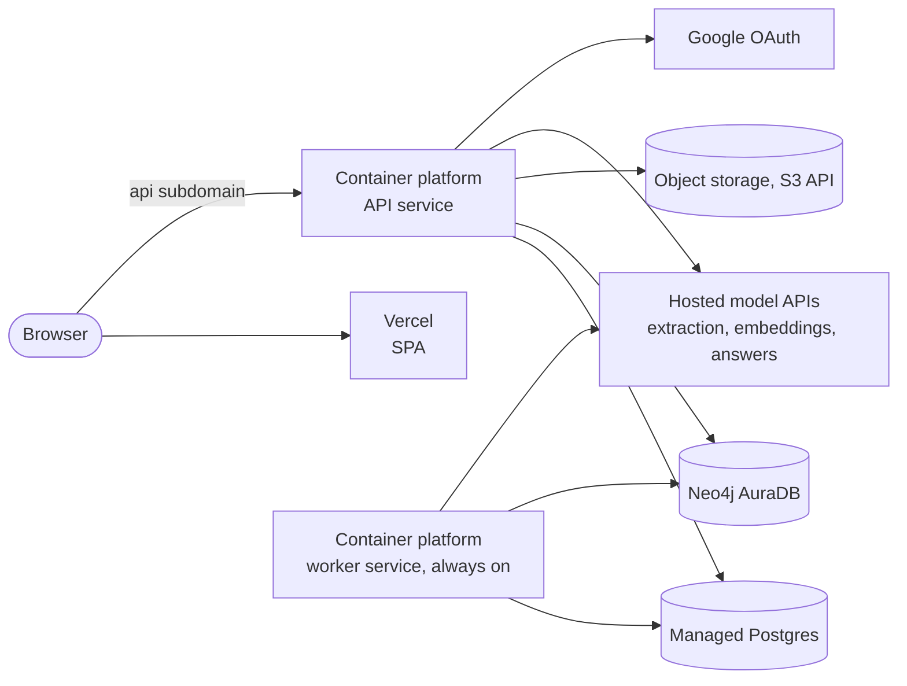
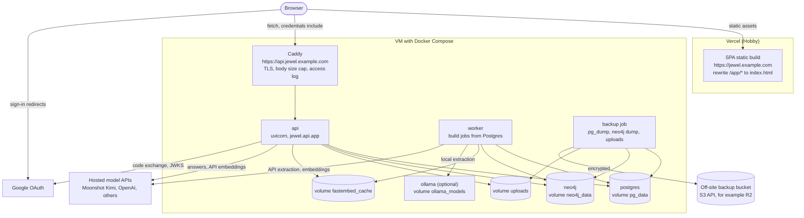
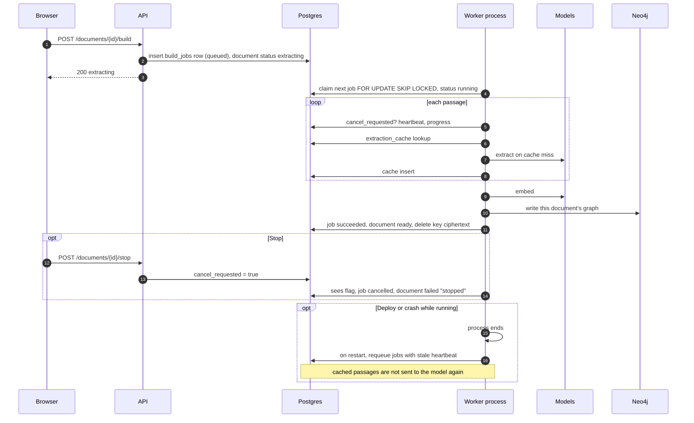
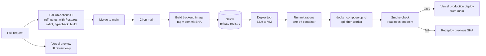

# jewel deployment strategy

This document proposes how to run jewel in production: where each component runs, how
requests reach it, what has to change in the code first, and how to deliver, secure and
operate it. Read [system-design.md](system-design.md) first; it describes the
components, the flows and the constraints in the current code that this plan responds
to.

Facts about third-party services (limits, free tiers, terms) were checked on 2026-09-29.
They are listed with sources in [Appendix A](#appendix-a-external-facts-checked-on-2026-09-29).
Anything not listed there is described qualitatively on purpose; check current pricing
before you commit.

Contents

1. [Summary](#1-summary)
2. [What has to be hosted](#2-what-has-to-be-hosted)
3. [Why the backend cannot run on Vercel serverless](#3-why-the-backend-cannot-run-on-vercel-serverless)
4. [Hosting options](#4-hosting-options)
5. [Recommended architecture](#5-recommended-architecture)
6. [Runtime changes before production](#6-runtime-changes-before-production)
7. [Environments and delivery pipeline](#7-environments-and-delivery-pipeline)
8. [Configuration and secrets](#8-configuration-and-secrets)
9. [Security, privacy and data](#9-security-privacy-and-data)
10. [Observability and operations](#10-observability-and-operations)
11. [Phased rollout and production-readiness checklist](#11-phased-rollout-and-production-readiness-checklist)
12. [Open decisions](#12-open-decisions)
13. [Appendix A: external facts checked on 2026-09-29](#appendix-a-external-facts-checked-on-2026-09-29)

## 1. Summary

Host the static frontend on Vercel (Hobby, for as long as jewel stays a personal,
non-commercial project) and run everything stateful or long-running on one always-on
Linux VM with Docker Compose: Caddy for HTTPS, the API, a separate build worker,
Postgres, Neo4j and, optionally, Ollama. Give the two halves one registrable domain,
for example `jewel.example.com` for the frontend and `api.jewel.example.com` for the API,
so the existing `SameSite=Lax` session cookie and single-origin CORS work without any
change to the auth code. Start on Oracle Cloud's Always Free Arm VM if a slow local
extraction model is acceptable, or on a small paid VPS if you want local Qwen to be
usable. Before the first public deploy, fix the server-key exposure, restrict outbound
model URLs, move builds out of the API process into a worker backed by a Postgres job
table, and replace schema-at-startup with a migration step.

## 2. What has to be hosted

| Component | Kind of workload | Needs persistent state | Notes for hosting |
|---|---|---|---|
| SPA | Static files built by `npm run build` into `frontend/dist` | No | Any static host or CDN. Needs a fallback from `/app/*` to `index.html` because it uses browser routing. `VITE_API_BASE_URL` is compiled in at build time. |
| API | Long-lived Python web process | No, after the changes in section 6 (today it holds build threads, cancel flags and local files) | Requests can last minutes (`/ask`). Loads local embedding models into memory. |
| Build worker | Long-running background jobs, CPU- or network-bound | No (state goes to Postgres and Neo4j) | Can run for a long time per document with a local model. Must survive deploys. Today it is a thread inside the API. |
| Postgres | Database | Yes | System of record: accounts, sessions, document text, extraction cache. |
| Neo4j 5 Community | Database | Yes | The per-user graphs. Community Edition backups need the database stopped (Appendix A). |
| Upload storage | Files | Yes, if originals are kept | Today a local directory. Never read after parsing (see system design, 5.2). |
| Ollama (optional) | Model server | Yes (model files, several GB) | CPU-only is possible but slow; GPU makes it practical. Only needed if local extraction is offered. |
| fastembed models | In-process in API and worker | Cache directory | Downloaded on first use; point `FASTEMBED_CACHE_PATH` at a persistent volume. |
| Hosted model APIs | External | No | OpenAI-compatible endpoints chosen per request; Kimi for answers by default. |
| Google OAuth | External | No | Needs an HTTPS redirect URI on a real domain name (Appendix A). |

## 3. Why the backend cannot run on Vercel serverless

Vercel is a good fit for the SPA. It is not a fit for the jewel backend, for reasons that
come from the code, not from preference:

1. **Long work after the response.** A build runs for minutes to hours after
   `POST /documents/{id}/build` has returned. Serverless functions are billed and kept
   alive per invocation with a bounded maximum duration; a background thread started
   inside one is not a supported way to run hours of work.
2. **No persistent disk.** Uploads are written to `JEWEL_UPLOAD_DIR` and fastembed caches
   model weights on disk. A function's filesystem does not persist between invocations.
3. **Local models.** Ollama is a separate server process holding a multi-gigabyte model,
   and fastembed loads ONNX models into process memory. Neither fits a function's
   lifecycle; every cold start would reload or re-download models.
4. **Request size.** Vercel Functions accept request bodies up to 4.5 MB (Appendix A);
   jewel accepts uploads up to 20 MB.
5. **Databases.** Neo4j and Postgres would still need to be hosted elsewhere, and the
   API keeps a Neo4j driver for the life of the process.

The SPA is plain static output and has none of these problems.

## 4. Hosting options

### Option A: Vercel for the SPA, one VM for everything else (recommended)

The SPA is deployed by Vercel from the Git repository. One VM runs Docker Compose with
Caddy, the API, the worker, Postgres, Neo4j and optionally Ollama. Caddy obtains and
renews TLS certificates automatically.

- **VM choices.** Oracle Cloud Always Free Ampere A1 currently gives the equivalent of
  2 OCPUs and 12 GB of memory, with 200 GB of block storage (Appendix A). That is enough
  for the API, worker, Postgres and Neo4j for one person or a few, and just about enough
  memory for a 7B model, but local Qwen extraction on two Arm cores will be slow. Oracle
  may also reclaim Always Free instances it considers idle. A small paid VPS (Hetzner,
  or similar) with more cores and memory costs a modest monthly fee and makes local
  extraction more usable; no GPU is assumed at this tier.
- **Fit with today's code.** Closest of the three. Local disk, local models and a
  long-lived process are all available. The code changes in section 6 are still needed
  for safety and restart-resilience, but nothing has to be rewritten for the platform.
- **Weaknesses.** You operate the VM: OS updates, backups, monitoring. One machine is a
  single point of failure.

### Option B: Vercel SPA plus managed services

The SPA on Vercel; Postgres on a managed service (Neon, Supabase or similar); Neo4j on
AuraDB; uploads in S3-compatible object storage such as Cloudflare R2; the API and worker
on a container platform (Render, Fly.io, Railway or Google Cloud Run); all model calls to
hosted APIs.



- **Fit with today's code.** Poor without changes. Local Ollama is not realistic on these
  platforms at low tiers, so extraction must go to hosted APIs. Uploads need an
  object-storage backend in `documents/storage.py` (or must not be kept). Free container
  tiers commonly sleep when idle and have ephemeral disks: Render's free web services spin
  down after 15 minutes without traffic, lose local files on restart, and free Render
  Postgres databases expire after 30 days (Appendix A). On Cloud Run with request-based
  CPU allocation, a background thread gets little or no CPU after the response is sent,
  so the current in-process build would stall. The worker has to be a separately
  deployed, always-on service.
- **AuraDB Free** holds up to 200,000 nodes and 400,000 relationships, pauses after 72
  hours without activity, and is deleted after 30 days of inactivity (Appendix A). That is
  workable for a demo and risky for data you care about. The code already accepts a
  `neo4j+s://` URI through `NEO4J_URI`.
- **Strengths.** Less machine administration; managed backups on paid tiers; each part
  scales separately.
- **Weaknesses.** Five or six accounts and dashboards; free tiers pause, sleep or expire;
  paid tiers add up across services; cross-provider latency on every graph load.

### Option C: everything on one VM, including the SPA

Same VM as option A, with Caddy also serving the built SPA and proxying `/api/*` to the
API on the same origin.

- **Fit with today's code.** Good. Same origin, so CORS is not involved and the cookie is
  first-party. Needs `VITE_API_BASE_URL=/api` and a path-stripping proxy rule (below).
- **Strengths.** One bill, one domain, no Vercel terms to consider, no proxy time limits
  beyond your own.
- **Weaknesses.** No preview deployments or CDN for the frontend unless you build them;
  frontend deploys go through the same pipeline as the backend.

### Comparison

| | A: Vercel + VM | B: Vercel + managed | C: one VM |
|---|---|---|---|
| Runs today's code with few changes | Yes | No (object storage, hosted-only models, separate worker) | Yes |
| Local Qwen and local embeddings | Yes (speed depends on the VM) | Embeddings only, with cold-start downloads; no practical Ollama | Yes |
| Persistent disk | Yes | Paid tiers only, or object storage | Yes |
| Frontend previews and CDN | Yes | Yes | No |
| Operations burden | Medium (one VM) | Low per service, high in total | Medium (one VM) |
| Free tier path | Vercel Hobby + Oracle Always Free + a domain | Several free tiers that pause, sleep or expire | Oracle Always Free + a domain |
| Commercial use | Needs Vercel Pro (Hobby is non-commercial only) | Needs Vercel Pro | No Vercel restriction |
| Main risk | Single VM; slow CPU inference on the free VM | Free-tier data loss, many moving parts | Single VM |

### Cost tiers (qualitative)

- **Free.** Vercel Hobby for the SPA, Oracle Always Free Arm VM for the rest, Cloudflare
  R2's free allowance (10 GB-month of standard storage, Appendix A) for off-site backups.
  The unavoidable cost is a domain name, a small yearly fee, because Google does not
  accept raw IP addresses as redirect hosts. Expect local extraction to be slow; prefer
  hosted extraction with the user's key.
- **Low.** A small paid VPS with more cores and memory in place of the free VM, same
  Compose setup. Add a paid uptime or log service only if the free ones are not enough.
  Model spend is whatever the server Kimi key is used for, plus nothing for user-keyed
  calls.
- **Scale.** Separate the worker onto its own machine (GPU if local models stay), move
  Postgres to a managed service, give Neo4j its own machine or a paid AuraDB tier, keep
  uploads in object storage, run more than one API replica behind a load balancer, and
  move the SPA to Vercel Pro if jewel becomes commercial.

## 5. Recommended architecture

Option A, with the frontend and the API on two subdomains of one domain you own.



Only Caddy is reachable from the internet (ports 80 and 443, plus SSH restricted to your
address or a VPN). Postgres, Neo4j and Ollama listen only on the Compose network.

### Why this shape

- It runs the current code with the fewest platform-driven changes: local disk, local
  models and long-lived processes are all available.
- It is the only free-tier path in which no component sleeps, pauses or expires on its
  own schedule (subject to Oracle's idle-reclamation rule).
- Vercel gives the frontend a CDN, per-branch previews and instant rollbacks without any
  work.
- Separating API and worker processes on the same machine is enough to make deploys safe
  for builds; moving the worker to its own machine later changes only the Compose file.
- If jewel becomes commercial, the SPA moves to Vercel Pro or into Caddy (option C)
  without touching the backend.

### Origins, cookies and OAuth

The session cookie is `SameSite=Lax`, host-only (no `Domain` attribute), `Path=/`, and
`Secure` whenever `JEWEL_ENV` is not `local`. The browser sends a `SameSite=Lax` cookie on
`fetch` only when the page and the API are the same site, meaning the same registrable
domain. `*.vercel.app` hosts are on the public suffix list, so `jewel.vercel.app` and an
API on any other domain are different sites and the cookie is never sent. There are two
ways to make them the same site.

#### Recommended: subdomains of one domain

`https://jewel.example.com` (Vercel) and `https://api.jewel.example.com` (Caddy on the
VM) are different origins but the same site. The cookie is set by and sent to
`api.jewel.example.com`; the existing CORS configuration (one allowed origin, with
credentials, methods GET/POST/DELETE, header Content-Type) covers the SPA's requests.
No backend code changes are needed for auth.

| Setting | Value |
|---|---|
| Vercel env `VITE_API_BASE_URL` | `https://api.jewel.example.com` |
| API `JEWEL_FRONTEND_URL` | `https://jewel.example.com` (redirect target after sign-in and the CORS origin; no trailing slash) |
| API `GOOGLE_REDIRECT_URI` | `https://api.jewel.example.com/auth/google/callback` |
| Google authorized redirect URI | exactly the same string |
| API `JEWEL_ENV` | `production` (turns on `Secure`) |
| DNS | `jewel` CNAME to Vercel; `api.jewel` A/AAAA record to the VM |

Keep `example.com` dedicated to jewel or at least to trusted services: any other
subdomain of the same registrable domain counts as same-site and could make cookie-bearing
requests to the API.

#### Alternative: Vercel rewrite proxy, one origin

If you do not want a domain for the frontend, Vercel can proxy `/api/*` to the VM so that
the browser sees a single origin (`https://jewel.vercel.app`). The VM still needs an
HTTPS host name for Vercel to connect to (a domain, or a free dynamic-DNS name with Caddy),
because Vercel should not forward cookies over plain HTTP.

```json
{
  "rewrites": [
    { "source": "/api/:path*", "destination": "https://api.jewel.example.com/:path*" },
    { "source": "/(.*)", "destination": "/index.html" }
  ]
}
```

Changes this requires, checked against the code:

- `VITE_API_BASE_URL=/api`. `api.ts` prefixes every request with it, and `SIGN_IN_URL`
  becomes `/api/auth/google`.
- `GOOGLE_REDIRECT_URI=https://jewel.vercel.app/api/auth/google/callback`, registered in
  Google. Google redirects the browser to Vercel, Vercel forwards to
  `/auth/google/callback` on the API, and the token exchange sends the same configured
  string, so it matches.
- `JEWEL_FRONTEND_URL=https://jewel.vercel.app`. The API's 302 after sign-in is an
  absolute URL and passes through the proxy unchanged.
- No FastAPI `root_path` or route prefix is needed: the rewrite strips `/api` before the
  request reaches the API. The cookie has no `Domain` and `Path=/`, so the browser stores
  it for `jewel.vercel.app` and sends it with every `/api/*` request. CORS is no longer
  exercised (same origin) and can stay as it is.

Limits that make this the second choice:

- Vercel ends proxied requests after 120 seconds (Appendix A). `/ask` can take longer
  (up to five model calls, each with a 120-second timeout and retries), so asks would
  fail intermittently until ask becomes asynchronous.
- Vercel documents a 4.5 MB request-body limit for Functions; no documented body limit
  for external rewrites was found. Test a 20 MB upload through the proxy before relying
  on it.
- Every request and cookie passes through Vercel, and proxied traffic counts against the
  Hobby allowances.

#### SPA fallback

The SPA uses browser routing (`/`, `/app`, `/app/graph`, `/app/ask`). A reload on
`/app/graph` must return `index.html`. Add a `frontend/vercel.json` (with the Vercel
project root set to `frontend/`):

```json
{
  "rewrites": [{ "source": "/(.*)", "destination": "/index.html" }]
}
```

This is the SPA rewrite that Vercel's Vite guide recommends; existing static files (the
hashed assets under `/assets/`, `favicon.svg`) are still served as files. In the proxy
variant, the `/api/:path*` rule must come first, as in the example above. In option C, the equivalent Caddy configuration is:

```text
jewel.example.com {
    handle_path /api/* {
        reverse_proxy api:8000
    }
    handle {
        root * /srv/jewel-frontend
        try_files {path} /index.html
        file_server
    }
}
```

`handle_path` strips `/api` before proxying, which gives the same routing as the Vercel
rewrite.

## 6. Runtime changes before production

System design section 5 lists the constraints. These are the changes that address them,
in the order they matter.

### 6.1 A build worker with a Postgres job queue

Replace the in-process thread with a job table and a worker process. Postgres is already
there and the volume is small, so no Redis or broker is needed (consistent with
ADR 0010).

- New table `build_jobs`: id, document id, user id, status (`queued`, `running`,
  `succeeded`, `failed`, `cancelled`), the extraction and embedding choices without keys,
  optional key ciphertext (see below), `cancel_requested`, `attempts`, `locked_by`,
  `heartbeat_at`, timestamps.
- `POST /documents/{id}/build` inserts a job and sets the document to `extracting` in one
  transaction, then returns. It no longer creates model clients beyond validating the
  choice.
- The worker (`python -m jewel.worker`, same image as the API) claims one job at a time
  with `SELECT ... FOR UPDATE SKIP LOCKED`, runs the existing `build_parsed_text`, updates
  progress as today, and writes a heartbeat every few seconds.
- `POST /documents/{id}/stop` sets `cancel_requested`. The worker checks it between
  passages and from a watcher thread that calls `OllamaChat.abort()`, replacing the
  in-memory cancel map.
- On start, and periodically, the worker requeues or fails jobs whose heartbeat is stale.
  Because passage results are in `extraction_cache`, a requeued build skips the passages
  it had already extracted, so resuming after a restart is cheap.
- Concurrency: one worker slot for Ollama jobs (the model can serve one request at a time
  on a small machine), a few slots for API-model jobs. This replaces the global lock that
  today serializes all users.
- On SIGTERM the worker stops claiming jobs and gives the current passage time to finish;
  anything unfinished is requeued at next start.



**User API keys for queued builds.** Today the key travels in the build request and lives
in the thread's memory. A worker in another process needs it too. Options:

1. Encrypt the key with `KEY_ENCRYPTION_SECRET` (currently unused), store the ciphertext on
   the job row, decrypt in the worker, and delete it when the job finishes or is cancelled.
   The key is at rest only for the life of the job. Recommended.
2. Let API-model builds run only with server-held keys. Simpler, but moves model cost to
   you.

### 6.2 Outbound model calls and the server key

- Use `KIMI_API_KEY` only when the request's base URL is exactly the Moonshot URL (or
  ignore client base URLs whenever the server key is used). Today a user can send an empty
  key and a base URL they control and receive the server key.
- Validate every client-supplied base URL: `https` only, host on an allowlist
  (for example `api.openai.com`, `api.moonshot.ai`, and any others you choose), or at
  minimum resolve the host and refuse private, loopback and link-local addresses.
- Add a setting to disable the server key entirely in an environment.

### 6.3 Migrations

Move `schema.sql` into numbered migration files tracked in a `schema_migrations` table
(a small runner in `jewel.db`, or a tool such as Alembic or yoyo). Run migrations as a
separate step in the deploy (section 7) and turn off schema application at API startup in
production. Put Neo4j constraints and indexes in the same step, at least uniqueness on
`(:Document {user_id, id})` and `(:Entity {user_id, name_key})`. Follow
expand-then-contract for breaking changes so the previous API version keeps working while
a deploy is in progress and after a rollback.

### 6.4 Files and models on persistent volumes

- `JEWEL_UPLOAD_DIR` on a named volume that is backed up. Object storage is only needed if
  the API moves to a platform without persistent disks, or for multiple API hosts; add an
  S3-compatible implementation of `FileStore` then. Alternatively decide not to keep
  originals at all (they are never read after parsing).
- `FASTEMBED_CACHE_PATH` on a volume shared by API and worker, and download the default
  embedding model during provisioning so the first user does not wait. Cache the embedder
  per process instead of creating it per request.
- `OLLAMA_URL=http://ollama:11434` for the worker, and `ollama pull qwen2.5:7b-instruct`
  as a provisioning step.

### 6.5 Everything else in Phase 0

- A readiness endpoint that checks Postgres and Neo4j, and a Neo4j driver that is created
  lazily or retried instead of once at startup.
- Production images: pinned `uv` version, non-root user, a `worker` command, no dev
  dependencies. A production Compose file with Caddy, restart policies, health checks,
  memory limits and log rotation.
- Rate limits and quotas per user (uploads per day, builds in flight, asks per minute,
  documents per account) enforced in the API with Postgres counters, plus a request body
  cap in Caddy slightly above 20 MB.
- Do not log OAuth callback query strings (turn off uvicorn's access log and let Caddy log
  with the query removed for that path, or filter it).
- A Content-Security-Policy and other security headers for the SPA in `vercel.json`,
  because typed keys sit in `sessionStorage`.
- Delete consistency: cancel a running build before deleting its document, and retry or
  record Neo4j deletes that fail instead of skipping them.

## 7. Environments and delivery pipeline

| Environment | Frontend | Backend | Data | Google OAuth |
|---|---|---|---|---|
| Local | Vite dev server, `localhost:5173` | uvicorn on the host, `localhost:8000` | Compose Postgres and Neo4j | Development project, redirect `http://localhost:8000/auth/google/callback` |
| Preview (per pull request) | Vercel preview URL on `*.vercel.app` | none (points at nothing, or at staging) | none | Sign-in does not work (see below) |
| Staging (Phase 2) | Vercel branch domain, for example `staging.jewel.example.com` | Second Compose project on the VM, `api-staging.jewel.example.com` | Separate Postgres and Neo4j databases | Redirect `https://api-staging.jewel.example.com/auth/google/callback` |
| Production | `jewel.example.com` | `api.jewel.example.com` | Production databases and volumes | Production project, redirect `https://api.jewel.example.com/auth/google/callback` |

**Previews and OAuth.** Google requires exact redirect URIs and does not accept wildcards
(Appendix A), and the API redirects to a single `JEWEL_FRONTEND_URL`. Preview URLs are
unique per deployment and live on `*.vercel.app`, which is a different site from the API,
so the cookie would not be sent anyway. Treat per-PR previews as visual review of the
signed-out landing page and static UI. For end-to-end testing, assign a fixed domain to a
`staging` branch in Vercel and run a staging backend whose `JEWEL_FRONTEND_URL` is that
domain.

### Pipeline



- **CI** is the existing `.github/workflows/ci.yml`; keep it as the gate.
- **Images.** A new workflow builds one backend image (used for both `api` and `worker`)
  and pushes it to GitHub Container Registry, tagged with the commit SHA. Packages for a
  private repository are private; the VM pulls with a read-only token.
- **Deploy.** A workflow job (manual approval via a GitHub environment is a good idea at
  first) connects over SSH, writes the new image tag into the Compose environment, pulls,
  runs migrations with the new image, restarts `api`, then `worker`, and checks readiness.
  The backend is deployed before the frontend so a new SPA never talks to an old API; API
  changes stay backward compatible for one release.
- **Frontend.** Vercel's Git integration deploys `main` to production. To keep the order
  above, either disable automatic production deploys and trigger them from the workflow
  after the smoke check, or accept that frontend and backend deploy independently and keep
  both backward compatible.
- **Zero downtime.** With one API container, a restart drops requests for a few seconds.
  That is acceptable in Phase 1. To avoid it, run two API containers behind Caddy with
  health checks and restart them one at a time. The worker needs no special handling once
  jobs are requeued automatically.
- **Rollback.** Backend: redeploy the previous image SHA; because migrations are
  expand-then-contract, the previous version runs on the new schema. Frontend: Vercel's
  instant rollback to the previous production deployment. Data: restore from backup only
  for data corruption, never as part of a routine rollback.

## 8. Configuration and secrets

### Per-component environment

| Variable | SPA build | API | Worker | Secret | Production value or note |
|---|---|---|---|---|---|
| `VITE_API_BASE_URL` | yes | | | no (public) | `https://api.jewel.example.com`, or `/api` in the proxy variant |
| `JEWEL_ENV` | | yes | yes | no | `production` |
| `GOOGLE_CLIENT_ID` | | yes | | no | From the production OAuth client |
| `GOOGLE_CLIENT_SECRET` | | yes | | yes | From the production OAuth client |
| `GOOGLE_REDIRECT_URI` | | yes | | no | `https://api.jewel.example.com/auth/google/callback` |
| `JEWEL_FRONTEND_URL` | | yes | | no | `https://jewel.example.com` |
| `SESSION_SECRET` | | yes | | yes | 32 random bytes, hex |
| `KEY_ENCRYPTION_SECRET` | | yes | yes | yes | Needed once job keys are encrypted (6.1) |
| `DATABASE_URL` | | yes | yes | yes | Points at the Compose `postgres` service |
| `NEO4J_URI`, `NEO4J_USER`, `NEO4J_PASSWORD` | | yes | yes | password yes | `bolt://neo4j:7687` on the VM, `neo4j+s://...` for AuraDB |
| `JEWEL_UPLOAD_DIR` | | yes | | no | Mount point of the uploads volume |
| `FASTEMBED_CACHE_PATH` | | yes | yes | no | Mount point of the model-cache volume (read by fastembed) |
| `OLLAMA_URL` | | | yes | no | `http://ollama:11434` (today the API also needs it because it builds) |
| `KIMI_API_KEY` | | yes | | yes | Optional; see 6.2 and open decisions |
| `POSTGRES_USER`, `POSTGRES_PASSWORD`, `POSTGRES_DB` | | | | password yes | For the Postgres container |
| `NEO4J_AUTH` | | | | yes | For the Neo4j container, `neo4j/<password>` |
| Neo4j memory settings | | | | no | Set heap and page cache explicitly on a small VM |
| Caddy domain and ACME email | | | | no | In the Caddyfile |
| Backup bucket credentials and repository password | | | | yes | Only on the VM, only for the backup job |
| GHCR read token, SSH deploy key | | | | yes | GitHub Actions secrets and the VM |

Keep production values in a root-owned env file on the VM (mode 600) referenced by the
Compose file, and in GitHub Actions and Vercel encrypted environment variables. Nothing
secret goes into the SPA build: every `VITE_*` value is public. Never commit `.env`.

### Google OAuth production setup

1. Create a separate Google Cloud project for production (Google recommends separate
   projects for development and production; Appendix A). Keep the current one for local
   development.
2. Configure the consent screen: app name, support email, the jewel domain as an
   authorized domain, links to a privacy policy and terms page (you need to publish these
   on the frontend).
3. Create a Web application OAuth client with exactly one authorized redirect URI:
   `https://api.jewel.example.com/auth/google/callback` (add the staging one to the staging
   project or client when staging exists). Redirect URIs must use HTTPS and a domain name,
   not an IP address, and must match exactly. Authorized JavaScript origins are not used by
   this server-side flow.
4. Decide the audience. In Testing status, only listed test users (at most 100) can sign
   in, which is a reasonable private beta. Publishing to In production opens sign-in to
   any Google account. jewel requests only `openid`, `email` and `profile`, which are not
   sensitive scopes; Google may still require verification before it shows the app's name
   and logo on the consent screen (Appendix A).

### Secret rotation

| Secret | How to rotate | Effect |
|---|---|---|
| `SESSION_SECRET` | Replace and restart the API | Every session becomes invalid (session ids are HMACs of the cookie token), so all users sign in again. Supporting two secrets at once would need a code change. |
| `GOOGLE_CLIENT_SECRET` | Create a new secret on the OAuth client, deploy it, then disable the old one (check the current Google console for secret rotation support) | None if done in that order |
| `KEY_ENCRYPTION_SECRET` | Only protects in-flight job keys; drain the queue, replace, restart | Queued jobs with old ciphertext must be resubmitted |
| Database passwords | Change in the database, update env, restart API and worker | Short restart |
| `KIMI_API_KEY` | Create a new key at the provider, deploy, revoke the old one | None |
| GHCR and SSH deploy credentials | Replace in GitHub and on the VM | None |

Rotate immediately if a secret appears in a log, a commit or a screenshot.

## 9. Security, privacy and data

**Tenant isolation.** Every document read and delete in Postgres filters by the session
user (status updates then use the id returned by that read), and every Cypher statement
takes `user_id` as a parameter; the user id always comes from the session, never from the
request body. `read_document` only opens documents returned by a
search in the same run. The test suite covers cross-user access for documents. Keep these
rules in any new code (job table, worker, rate limits) and add tests for them. The one
shared table is `extraction_cache`, keyed by a hash of model, prompt, options and passage
text; users cannot query it, but it means one user's passage text can produce a cache hit
for another user who uploads the identical passage.

**In transit.** Browser to Vercel and browser to Caddy are HTTPS. The API uses HTTPS to
Google and to hosted model APIs. Inside the VM, traffic stays on the Compose network. If
Postgres or Neo4j move to managed services, use TLS connections (`sslmode=require`,
`neo4j+s://`).

**At rest.** Postgres holds the full extracted text of every document and Neo4j holds it
again on each `Document` node, so both are as sensitive as the originals. Use provider
disk encryption where available (check your VM provider's default), and encrypt backups
client-side before they leave the VM (restic does this by default). Session tokens are
stored only as HMACs.

**User-provided keys.** Verified in the code: extraction, embedding and answer keys arrive
in the request body, are held on the model client object for that request or build, and
are not written to Postgres, Neo4j or logs by jewel. They are, however, stored in the
browser's `sessionStorage` and pass through any proxy in front of the API. After the
worker change, a key is stored encrypted only for the life of its job (6.1).

**Deletion semantics today.**

- Deleting a document removes the Postgres row, the file, and the document's Neo4j node,
  relationships and orphaned entities, provided Neo4j is reachable at that moment.
- Extraction-cache entries for the document's passages remain.
- There is no account deletion. Before opening sign-up to the public, add a "delete my
  account" action that removes the user's Neo4j subgraph, files, documents, sessions and
  user row, and state in the privacy policy that anonymous cache entries remain, or delete
  them too (the cache would need a document or user reference).

**Backups and restore.**

| Data | Method | Frequency | Restore |
|---|---|---|---|
| Postgres | `pg_dump -Fc` from a sidecar or cron job, pushed to an encrypted restic repository in an off-site bucket | Nightly, keep 7 daily and 4 weekly | `pg_restore` into an empty database |
| Neo4j Community | `neo4j-admin database dump`, which needs the database stopped in Community Edition (Appendix A); stop the container for the dump window, or snapshot the volume | Nightly, at a quiet hour | `neo4j-admin database load` into a stopped instance |
| Uploads | restic of the uploads volume | Nightly | Copy back |
| Config | Compose files and Caddyfile in Git; the env file in a password manager | On change | Re-provision |

Neo4j data can in principle be regenerated from Postgres (text plus cached extraction
output) with only embedding cost, but there is no tool for that today, so back it up.
Test a full restore onto a scratch VM before inviting other users, and then every quarter.

## 10. Observability and operations

**Health.** Keep `GET /health` as liveness for Docker and Caddy. Add a readiness endpoint
that checks Postgres and Neo4j, and point the external uptime monitor and the deploy smoke
check at it.

**Logs.** API and worker log to stdout; Docker's json-file driver with a size limit and
rotation keeps the disk safe. Caddy writes structured access logs. Never log document
text, model prompts, API keys or OAuth codes. Add a request id to API logs and pass the
document id and job id through the worker logs so a failed build can be traced.

**Metrics worth adding.** Build queue depth and age of the oldest queued job; build
duration and passages per minute by model; extraction-cache hit rate; model call errors
and latency by provider; ask latency and tool-call count; 4xx and 5xx rates; disk use of
each volume; container memory. A Prometheus endpoint scraped by a hosted Grafana free
tier or a self-hosted stack is enough.

**Alerts.** Readiness failing for more than a few minutes; disk above 80 percent; no
successful backup in 26 hours (a heartbeat check); oldest queued job older than an hour;
build failure rate spiking; memory near the container limit (Ollama and Neo4j are the
likely causes).

**Build failures.** The document shows `failed` with a short error; the user can press
Build again, and cached passages are not re-sent to the model. Stuck `extracting`
documents disappear once the worker requeues stale jobs. Keep the raw error in logs and
only a short message in the row, as today.

**Capacity notes.** On a 12 GB VM, budget memory explicitly: a 7B model in Ollama at the
usual 4-bit quantization needs roughly 5 GB; give Neo4j a fixed heap and page cache
(1 to 2 GB total is plenty for a personal graph); Postgres needs little; the API and
worker each load a local embedding model (the large ones use noticeably more memory than
BGE base). These are estimates; measure with `docker stats` after the first builds. CPU
extraction speed on two Arm cores is the main unknown: time a ten-page document before
offering local extraction to anyone else. Ask and graph requests load the whole user graph
into memory, so memory per request grows with library size; add a per-user graph cache
(invalidated on build and delete) before libraries get large.

**Routine operations.** Automatic security updates on the VM; SSH by key only; Docker
image updates for Postgres, Neo4j and Caddy on a monthly schedule, with a backup first;
watch Oracle's idle-reclamation rule if the instance is mostly quiet.

## 11. Phased rollout and production-readiness checklist

Items marked **Srikar** need your accounts, consoles or decisions and cannot be done from
the code. Items marked **code** can be done in the repository by anyone.

### Phase 0: code changes before any public deploy

- [ ] **code** Use the server `KIMI_API_KEY` only with the fixed Moonshot base URL; add a
      setting to disable it (6.2).
- [ ] **code** Validate and allowlist outbound model base URLs; refuse private addresses
      (6.2).
- [ ] **code** `build_jobs` table, `jewel.worker` process, cancel via Postgres, stale-job
      requeue; remove the in-process thread, lock and cancel map (6.1).
- [ ] **code** Encrypted, job-scoped storage of user keys for API-model builds, using
      `KEY_ENCRYPTION_SECRET` (6.1), or the decision to allow only server keys.
- [ ] **code** Migration runner and migration files; Neo4j constraints; no schema
      application at API startup in production (6.3).
- [ ] **code** Readiness endpoint; lazy or retrying Neo4j driver (6.5).
- [ ] **code** Production Dockerfile (pinned uv, non-root, worker command),
      `infra/docker-compose.prod.yml`, `infra/Caddyfile` (6.4, 6.5).
- [ ] **code** Per-user rate limits and document quota; Caddy body-size cap (6.5).
- [ ] **code** Keep OAuth codes out of access logs (6.5).
- [ ] **code** `frontend/vercel.json` with the SPA fallback and security headers (5, 6.5).
- [ ] **code** Cancel the build before deleting a document; do not skip failed Neo4j
      deletes (6.5).
- [ ] **code** Cache the embedder per process; set `FASTEMBED_CACHE_PATH` in images and
      Compose (6.4).
- [ ] **code** Image build and deploy workflows (section 7).
- [ ] **code** Update `.env.example`, `problem-statement.md`, `architecture.md` and
      ADR 0006 to match the decisions taken here.

### Phase 1: first deploy on the free or cheap stack

- [ ] **Srikar** Answer the open decisions in section 12, at least 1 to 5.
- [ ] **Srikar** Buy a domain (or pick the proxy variant and a dynamic-DNS name).
- [ ] **Srikar** Create the VM (Oracle Always Free Ampere A1, Ubuntu, Arm image; or a paid
      VPS), add your SSH key, open ports 80 and 443, restrict SSH.
- [ ] **Srikar** DNS: `api.jewel` A/AAAA record to the VM; `jewel` CNAME to Vercel.
- [ ] **Srikar** Vercel: import the repository, root directory `frontend`, framework
      preset Vite, set `VITE_API_BASE_URL`, attach the domain. Confirm the project is
      personal and non-commercial for Hobby.
- [ ] **Srikar** Google Cloud: production project, consent screen in Testing, test users,
      Web OAuth client with the production redirect URI.
- [ ] **Srikar** Generate `SESSION_SECRET`, `KEY_ENCRYPTION_SECRET`, database passwords;
      write the VM env file; add GitHub Actions secrets (SSH key, host, GHCR read token).
- [ ] **Srikar** Create the off-site backup bucket and its credentials.
- [ ] **Srikar** Optional: a Moonshot key for `KIMI_API_KEY`, with a spending limit at the
      provider if it offers one.
- [ ] **code** Provision the VM from the repository: Docker, Compose files, Caddyfile,
      `ollama pull` if local extraction is enabled, fastembed pre-download, backup cron.
- [ ] **code** First deploy through the pipeline; run migrations; smoke test: sign in,
      upload a PDF and a `.docx`, build with an API model and with local Qwen, stop a build,
      restart the worker mid-build and watch it resume, ask a question, delete a document,
      sign out.
- [ ] **code** Run one backup and one restore onto a scratch database.

### Phase 2: hardening

- [ ] **code** Staging: second Compose project and databases on the VM, Vercel branch
      domain for `staging`; **Srikar** adds the staging redirect URI and DNS records.
- [ ] **code** Metrics, uptime monitor on the readiness endpoint, backup heartbeat,
      alerts (section 10); **Srikar** creates the monitoring accounts.
- [ ] **code** Account deletion and a data-export action; privacy policy and terms pages
      on the frontend. **Srikar** approves their wording.
- [ ] **Srikar** Decide whether to publish the OAuth app beyond test users, and complete
      whatever verification Google asks for.
- [ ] **code** Two API containers with health-checked rolling restarts, if brief deploy
      downtime matters.
- [ ] **code** VM hardening checklist: unattended upgrades, fail2ban or equivalent,
      firewall rules, Docker log rotation, Neo4j memory settings.
- [ ] **code** Quarterly restore test documented as a runbook.

### Phase 3: scale

- [ ] **code** Per-user graph cache in the API, invalidated on build and delete; a vector
      index (Neo4j or pgvector) instead of linear scans once libraries are large.
- [ ] **code** Asynchronous ask with progress events (Server-Sent Events or polling), so
      no proxy timeout applies and the trace can stream.
- [ ] **code** Object-storage `FileStore`, or drop original retention.
- [ ] **Srikar** Move the worker to its own machine (GPU if local models stay, or
      hosted models only), Postgres to a managed service, Neo4j to its own machine or a paid
      AuraDB tier.
- [ ] **Srikar** Vercel Pro, or serve the SPA from Caddy, if jewel becomes commercial.

## 12. Open decisions

1. **Domain or proxy.** Buy a domain and use subdomains (recommended), or stay on
   `jewel.vercel.app` with the rewrite proxy and accept the 120-second limit until ask is
   asynchronous?
2. **VM.** Oracle Always Free (free, 2 Arm cores, slow local extraction, idle
   reclamation) or a small paid VPS (a monthly fee, faster and predictable)?
3. **Local extraction in production.** Offer local Qwen at all, or extraction only through
   hosted APIs with the user's key? This decides whether Ollama runs on the VM and how
   much memory it needs.
4. **The server Kimi key.** Keep a server-paid answer model for everyone (then with
   quotas), only for you, or require every user to bring a key?
5. **Keys for queued builds.** Store user keys encrypted for the life of a job, or build
   only with server-held keys?
6. **Who can sign in.** Stay in Google's Testing mode with a list of up to 100 test users,
   add an email allowlist in the app, or publish to everyone?
7. **Original files.** Keep uploaded originals (and back them up), or delete them after
   parsing since nothing reads them?
8. **Staging.** Needed for the first release, or after it?
9. **Commercial intent.** If jewel may ever earn money, plan for Vercel Pro or option C
   from the start.
10. **Data retention.** How long to keep documents of inactive accounts, and whether the
    shared extraction cache is acceptable under your privacy policy.

## Appendix A: external facts checked on 2026-09-29

| Fact | Source |
|---|---|
| Vercel Hobby is restricted to non-commercial personal use; commercial use (including donations, ads, paid work on the site) needs Pro or Enterprise. | [Vercel fair use guidelines](https://vercel.com/docs/limits/fair-use-guidelines), [Vercel terms](https://vercel.com/legal/terms) |
| Proxied requests (rewrites to an external destination) time out after 120 seconds on every Vercel plan. | [Vercel limits](https://vercel.com/docs/limits#proxied-request-timeout) |
| Vercel Functions accept request and response bodies up to 4.5 MB. No separate body limit for external rewrites was found in the docs. | [Vercel Functions limitations](https://vercel.com/docs/functions/limitations) |
| Oracle Always Free Ampere A1: 1,500 OCPU hours and 9,000 GB hours per month, equivalent to 2 OCPUs and 12 GB of memory; 200 GB of block volume storage; idle Always Free instances may be reclaimed. | [Oracle Always Free resources](https://docs.oracle.com/en-us/iaas/Content/FreeTier/freetier_topic-Always_Free_Resources.htm) |
| Neo4j AuraDB Free: up to 200k nodes and 400k relationships; paused automatically after 72 hours of inactivity; deleted after 30 days without activity. | [AuraDB FAQ](https://neo4j.com/cloud/platform/aura-graph-database/faq/), [Aura instance actions](https://neo4j.com/docs/aura/managing-instances/instance-actions/) |
| Neo4j Community Edition: database dumps require the database to be stopped. | [Neo4j operations manual, offline backup](https://neo4j.com/docs/operations-manual/current/backup-restore/offline-backup/) |
| Cloudflare R2 free tier: 10 GB-month of standard storage, 1 million Class A and 10 million Class B operations per month; no egress charges. | [R2 pricing](https://developers.cloudflare.com/r2/pricing/) |
| Render free web services spin down after 15 minutes without inbound traffic, have an ephemeral filesystem and cannot attach persistent disks; free Render Postgres databases expire 30 days after creation. | [Render free instances](https://render.com/docs/free) |
| Google OAuth redirect URIs must use HTTPS (localhost exempt), cannot use raw IP addresses (localhost IPs exempt), cannot contain wildcards, and must match exactly. | [Google OAuth 2.0 for web server apps](https://developers.google.com/identity/protocols/oauth2/web-server) |
| Google OAuth apps in Testing status are limited to 100 test users; In production apps are available to any Google account; verification may be required before the app name and logo are shown or for sensitive scopes. Google recommends separate projects for development and production. | [Manage app audience](https://support.google.com/cloud/answer/15549945), [Submitting your app for verification](https://support.google.com/cloud/answer/13461325) |
