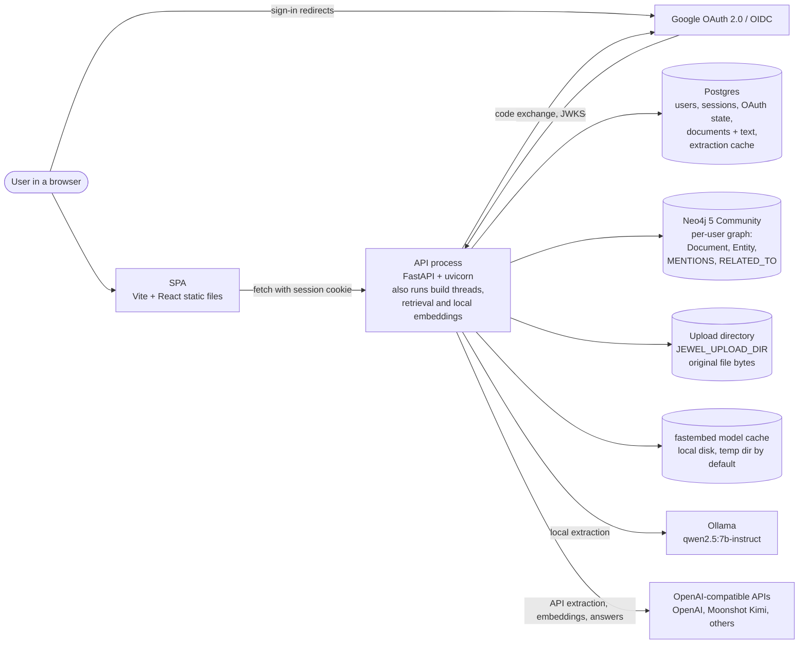
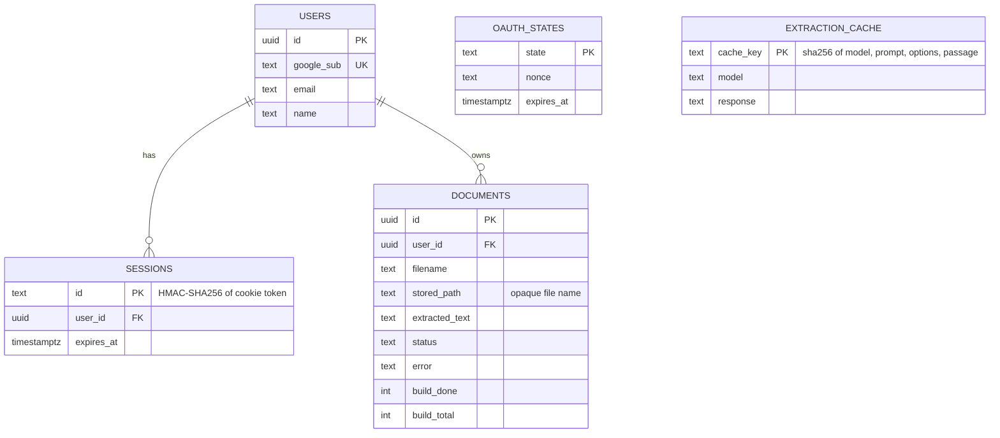
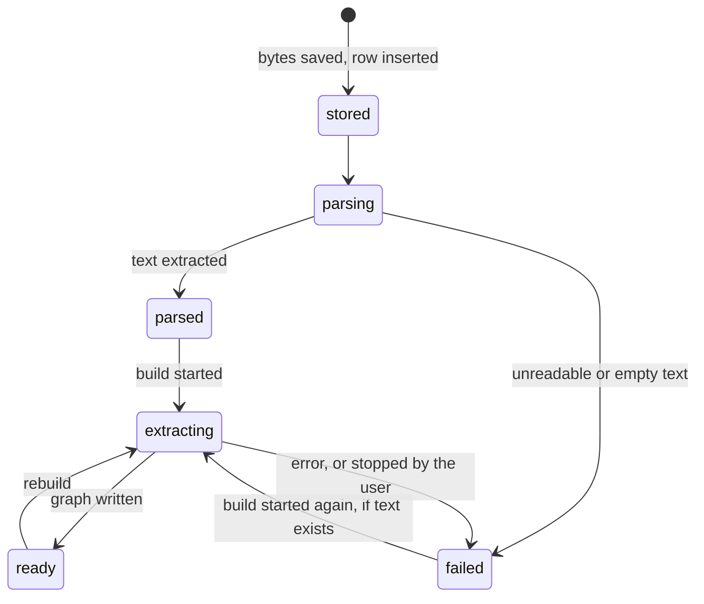
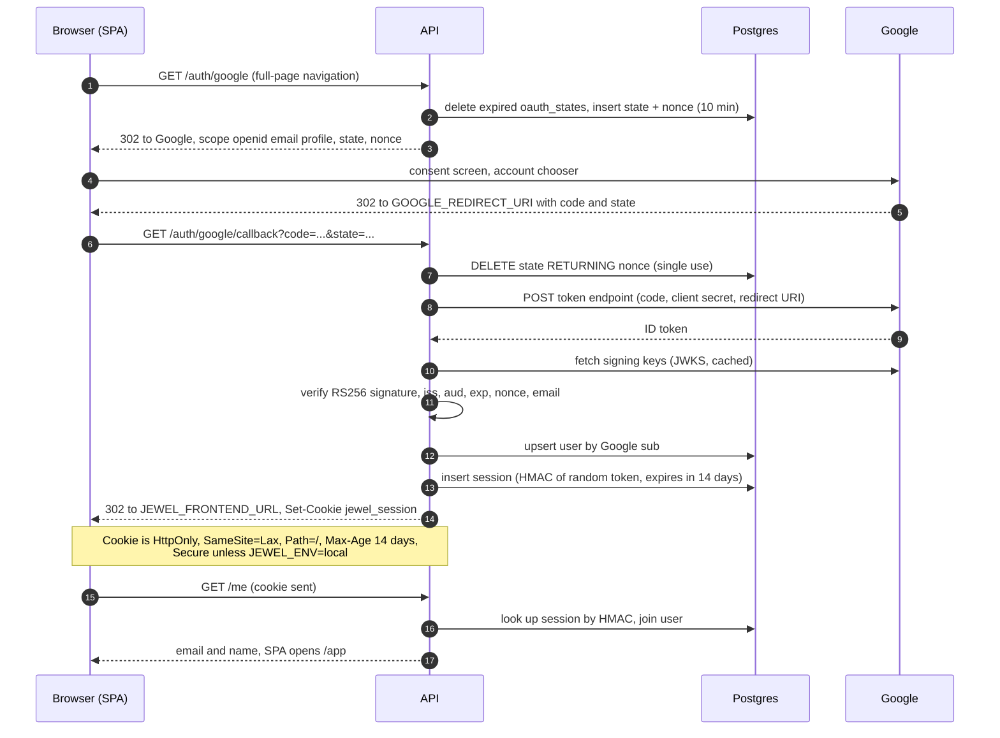
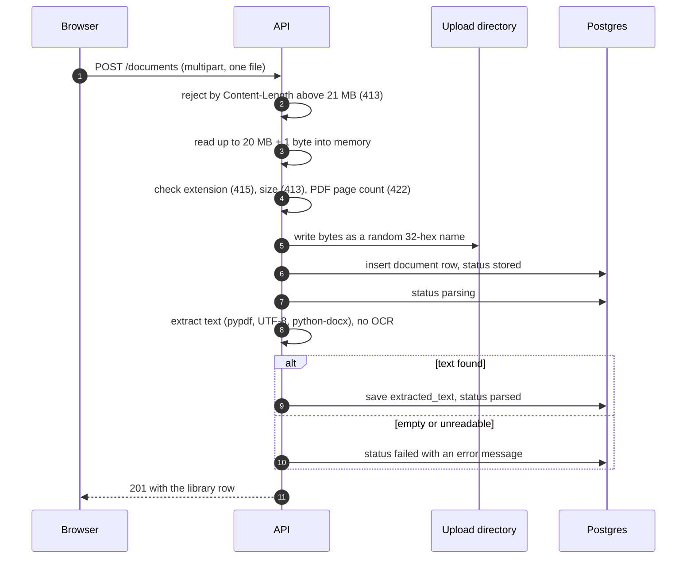
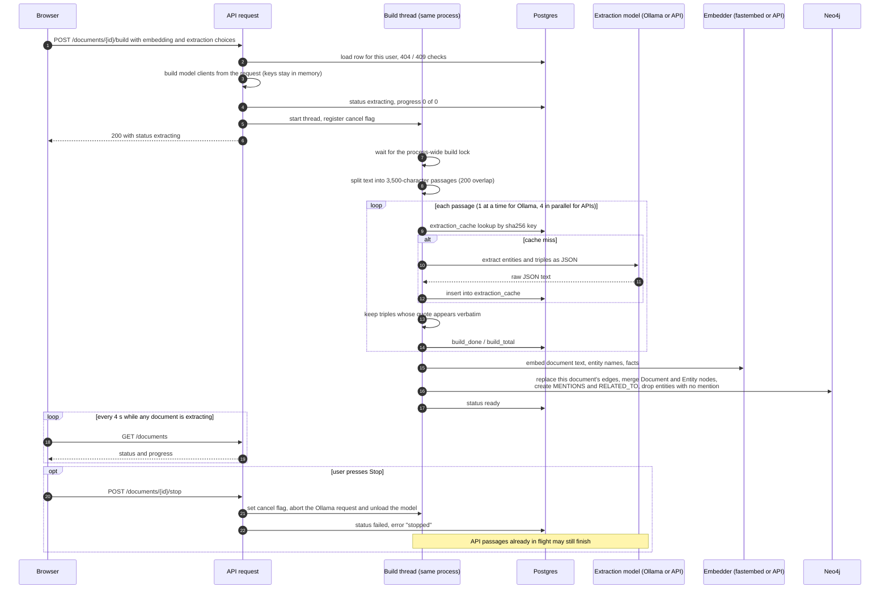
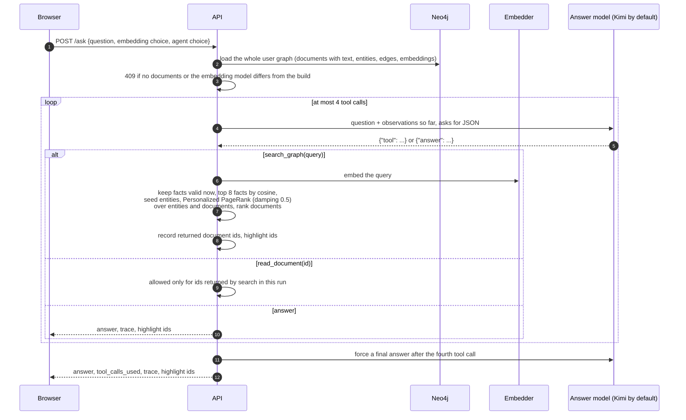
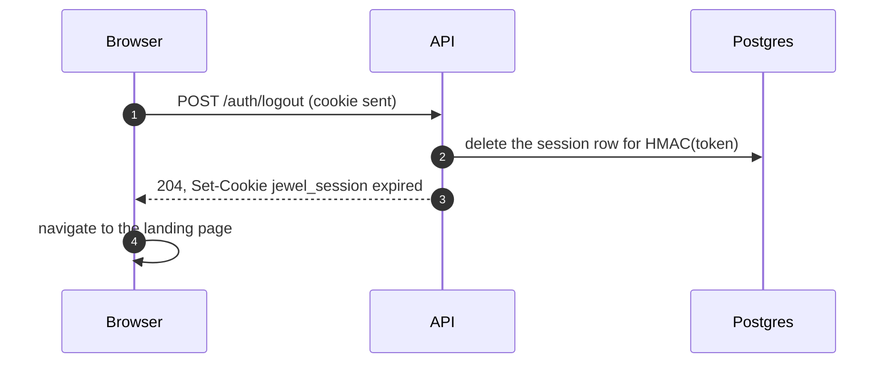

# jewel system design

This document describes how jewel works as a system today: the components, the state
each one holds, the main request flows, and the properties of the current code that
matter for running it in production. It is based on the code on `main` at commit
`05b54d5` (after PR #3). The companion document,
[deployment-strategy.md](deployment-strategy.md), uses this as its starting point and
describes how to host it.

Contents

1. [System context](#1-system-context)
2. [Components and the state they hold](#2-components-and-the-state-they-hold)
3. [Data model](#3-data-model)
4. [Key flows](#4-key-flows)
5. [Production constraints in the current code](#5-production-constraints-in-the-current-code)
6. [Where the older docs differ from the code](#6-where-the-older-docs-differ-from-the-code)

## 1. System context

jewel has one browser application, one API process, two databases, a directory of
uploaded files, and several model back ends. Google is used only for identity.

## 2. Components and the state they hold

| Component | What it does | State it holds | Where in the code |
|---|---|---|---|
| Browser SPA | Landing page, signed-in workspace (Documents, Graph, Ask), model pickers. Calls the API with `credentials: 'include'`. Polls the library every 4 seconds while a build is running. | Model choices, including any typed API keys, in `sessionStorage` (per tab). No tokens in `localStorage`. The session cookie is `httpOnly`, so scripts cannot read it. | `frontend/src/lib/api.ts`, `components/EmbeddingPicker.tsx`, `components/DocumentLibrary.tsx` |
| API | Sign-in, sessions, uploads and parsing, starting and stopping builds, graph reads, the agent. One uvicorn process. | In memory: the Neo4j driver, a global build lock, and a map of running builds with their cancel flags. On disk: uploaded files and the fastembed model cache. | `backend/src/jewel/api/` |
| Build worker | Runs a document build (extraction, embeddings, graph write). Today this is a daemon thread started by `POST /documents/{id}/build` inside the API process, not a separate service. A process-wide lock lets only one build run at a time, across all users. | Progress in Postgres (`build_done`, `build_total`); cancel flags in API memory. | `api/routes/documents.py`, `ingestion/live.py` |
| Postgres | System of record for accounts and documents. | `users`, `sessions` (HMAC of the cookie token, 14-day expiry), `oauth_states` (state and nonce, 10-minute expiry), `documents` (metadata, status, error, progress, full extracted text), `extraction_cache` (raw model output per passage, shared across users). | `db/schema.sql` |
| Neo4j | The knowledge graph. Every node and relationship carries `user_id`, and every query filters on it. | `Document` nodes (filename, full raw text, embedding, embedding model name), `Entity` nodes (name, type, embedding), `MENTIONS` and `RELATED_TO` relationships (quote, document id, validity time, and an embedding on `RELATED_TO`). No indexes or constraints are created by the code. | `kg/neo4j_store.py` |
| File storage | Keeps the uploaded bytes under an opaque 32-hex-character name. | Local directory `JEWEL_UPLOAD_DIR`. The bytes are written on upload and deleted with the document. Nothing reads them back after parsing: the text used by builds and answers comes from Postgres and Neo4j. | `documents/storage.py` |
| Local model serving | Ollama serves `qwen2.5:7b-instruct` for extraction. fastembed runs local embedding models (BGE base and large, Nomic v1.5, multilingual E5 large) inside the API process. | Ollama keeps its own model store. fastembed downloads weights on first use into a temp directory unless `FASTEMBED_CACHE_PATH` is set. | `llm/ollama.py`, `llm/embedders.py` |
| Hosted model APIs | Any OpenAI-compatible `/chat/completions` and `/embeddings` endpoint, chosen per request. The answer model defaults to `kimi-k2.6` at `https://api.moonshot.ai/v1`. | None in jewel. Keys arrive in the request body and live only on the model client object for that request or build. | `llm/choices.py`, `llm/openai_chat.py` |
| Google | Identity only (`openid email profile`). | Nothing stored by jewel except the Google subject id, email and name in `users`. No Google access or refresh tokens are kept. | `auth/google.py` |

### How model choices and keys flow

Every build and every question carries its own model choice in the JSON body. There is no
per-user key storage and no key route (`api/routes/keys.py` is an unmounted stub).

| Role | Request field | Choices | Key used |
|---|---|---|---|
| Extraction (build) | `extraction: {provider, model, base_url, api_key}` | `local` with `qwen2.5:7b-instruct` only, or `api` with any model and base URL | The key in the request. Required for `api`. |
| Embeddings (build and ask) | top-level `provider, model, base_url, api_key` | `local` with one of four fastembed models, or `api` with any model and base URL | The key in the request. Required for `api`. |
| Answer model (ask) | `agent: {model, base_url, api_key}` | Any OpenAI-compatible chat model; defaults to `kimi-k2.6` | The key in the request, or the server's `KIMI_API_KEY` when the request key is empty. |

A question must use the same embedding model that the user's documents were built with;
the API returns 409 otherwise, and 409 if the graph mixes embedding models.

## 3. Data model

The graph in Neo4j mirrors the `documents` table by id. `Document.id` in Neo4j equals
`documents.id` in Postgres, and `user_id` is the Postgres user id. There is no foreign key
between the two stores; consistency depends on the API writing both.

Document status moves through these states:

A document can be deleted in any state; deletion removes the row rather than setting a
status.

## 4. Key flows

### 4.1 Sign-in

The API runs the OAuth 2.0 authorization-code flow itself. `state` and the OIDC `nonce`
are stored in Postgres, not in a cookie, and each state can be used once.

Any failure (user denied, missing code, unknown or expired state, bad token) redirects to
`JEWEL_FRONTEND_URL?signin_error=<reason>` and sets no cookie.

### 4.2 Upload and parse

Parsing is synchronous: the upload request returns only after text extraction has
finished.

### 4.3 Graph build, progress and stop

`POST /documents/{id}/build` validates the request, marks the document `extracting`,
starts a daemon thread and returns at once. The thread does the work.

Only the document being built is extracted. Earlier documents are not reprocessed; new
entities are merged with existing ones by case-folded name inside the same user.

### 4.4 Ask

The question is answered synchronously inside one HTTP request. The agent loop is plain
Python (`agents/graph.py`); LangGraph is not used.

A question makes up to five calls to the answer model. Each call has a 120-second
timeout and up to three attempts on network errors, so a slow provider can hold the
request open for minutes. The HippoRAG recognition-memory filter exists in
`retrieval/hippo/recognition.py` but the ask path does not pass it a model, so it does
not run.

### 4.5 Sign-out

Sign-out ends only the current session. Sessions on other devices stay valid until they
expire, and expired session rows are never purged.

## 5. Production constraints in the current code

These are properties of the code as it is now. The deployment strategy explains what to
do about each one; section 11 of that document turns them into a checklist.

### 5.1 Work and processes

1. **Builds run inside the API process.** A build is a daemon thread. A deploy, crash or
   restart kills every running build and leaves those documents in `extracting` with no
   thread behind them. The build route then refuses them ("already being built") until
   the user presses Stop, which marks them `failed`. The cancel flags and the build lock
   live in process memory, so the API cannot be run as more than one process or replica
   without breaking Stop and the one-build-at-a-time rule.
2. **One build at a time for everyone.** The global lock serializes builds across users.
   With local Qwen on CPU a single paper can take a long time, and every other user's
   build waits behind it.
3. **Parsing and asking are synchronous.** Upload parses in the request. Ask runs up to
   five model calls in the request. Any proxy in front of the API with a short timeout
   will cut these off.
4. **Local models download at first use.** fastembed fetches weights the first time a
   model is used, into a temp directory by default, so a fresh container downloads them
   again. The embedder object is created per request, so the model is loaded again for
   each build and each question. Ollama must already have `qwen2.5:7b-instruct` pulled,
   and the API reaches it at `OLLAMA_URL` (default `http://127.0.0.1:11434`, which does
   not work from inside a container).

### 5.2 Storage and data

5. **Uploads are on local disk.** `JEWEL_UPLOAD_DIR` must be a persistent volume, or
   uploads are lost on redeploy. Because the bytes are never read after parsing, the
   originals are kept only for record-keeping; the product works without them.
6. **Schema is applied at startup.** `schema.sql` runs on every start (`CREATE ... IF NOT
   EXISTS`, `ADD COLUMN IF NOT EXISTS`). This works for additive changes but offers no
   versioning, no down-migrations and no way to run a data migration once.
7. **No Neo4j indexes.** Every write matches `Entity {user_id, name_key}` and
   `Document {user_id, id}` without an index or uniqueness constraint.
8. **Whole-graph loads.** `/ask` and `/graph` read the user's entire graph, including all
   embedding vectors and the full text of every document, into Python on every request.
   Similarity search is a linear scan. This is fine for a personal library and grows
   linearly with it.
9. **Cross-store deletes are best effort.** Deleting a document removes the Postgres row
   and the file, then the Neo4j document, its relationships and orphaned entities. If
   Neo4j is unavailable at that moment, the graph data is left behind silently. If a build
   is running when the document is deleted, the thread can still write the graph
   afterwards. There is no account deletion; deleting a user row would cascade in Postgres
   but not in Neo4j or the upload directory. The shared `extraction_cache` keeps model
   output (including verbatim quotes from the file) after the document is deleted.

### 5.3 Security

10. **Server key exposure through a client-supplied base URL.** For the answer model the
    API uses `KIMI_API_KEY` when the request has no key, but it takes the base URL from
    the request. A signed-in user can send an empty key and their own base URL and
    receive the server's Kimi key in the `Authorization` header. This must be fixed
    before any public deployment (only use the server key with the fixed Moonshot URL).
11. **Outbound requests to user-chosen URLs.** Extraction, embedding and answer base URLs
    are accepted from the request, so the API will send requests to any host, including
    internal addresses such as the Neo4j HTTP port or a cloud metadata endpoint. Outbound
    targets need an allowlist or at least a block on private and link-local ranges.
12. **Shared server key cost.** When `KIMI_API_KEY` is set, every signed-in user's
    questions are billed to it, and there is no per-user rate limit or quota.
13. **Cookie and CORS assumptions.** The cookie is `SameSite=Lax` with no `Domain`
    attribute, and CORS allows exactly one origin. The browser sends the cookie only if the
    SPA and the API are the same site (same registrable domain). A SPA on `*.vercel.app`
    calling an API on a different domain will never be signed in.
14. **Keys in the browser.** Typed API keys are stored in `sessionStorage` and sent in
    request bodies. Any script injected into the page could read them. There is no
    Content-Security-Policy.
15. **Secrets and env loading.** Settings come from environment variables or a `.env`
    in the working directory; `KIMI_API_KEY` and `OLLAMA_URL` are read only from the
    process environment. Nothing reads a secret store.
16. **Limits.** Per-file caps exist (20 MB, 50 PDF pages). There is no limit on the number
    of documents, request rate, total storage per user, or passage count per build.
17. **Logs.** There is no structured logging. uvicorn's access log records the OAuth
    callback URL, including the single-use code and state.

### 5.4 Operations

18. **Health check is liveness only.** `GET /health` returns `{"status": "ok"}` without
    touching Postgres or Neo4j. If Neo4j is unreachable at startup, the API still starts,
    logs the error, and returns 503 on build, graph and ask until it is restarted (the
    driver is created once, at startup).
19. **Container images are for development.** The backend Dockerfile installs with
    `uv:latest` and runs as root; the frontend Dockerfile runs the Vite dev server. Neither
    is a production image.

## 6. Where the older docs differ from the code

`docs/problem-statement.md`, `docs/architecture.md`, `docs/open-questions.md`,
ADR 0014 and `backend/README.md` were written for the scaffold. The code now differs in
these ways:

| Older docs say | Code does |
|---|---|
| Users save an encrypted xAI key; all model calls go to `https://api.x.ai/v1` | No key storage. Model choice and key are sent per request. Extraction is local Qwen or any OpenAI-compatible API; embeddings are local fastembed or an API; answers default to Kimi. `KEY_ENCRYPTION_SECRET`, `JEWEL_LLM_MODEL`, `JEWEL_EMBEDDING_MODEL` and `LLM_BASE_URL` are unused. |
| Status `waiting_for_key`; PDF, txt, md only | Statuses `stored`, `parsing`, `parsed`, `failed`, `extracting`, `ready`; `.docx` is accepted too. |
| LangGraph agent, trace streamed with Server-Sent Events, ask run ids | A plain Python loop, one synchronous `POST /ask`, no run ids or persistence. |
| Recognition-memory filter runs on each search | Implemented but not wired into `/ask`. |
| Neo4j vector index | No indexes; similarity is computed in Python. |
| Cytoscape.js graph view, delete node or edge, per-document filter | A list-based graph panel; no entity or relationship delete routes. |
| Text-search comparison | `retrieval/baseline_rag.py` exists but no route uses it. |
| Only `/health` is mounted (architecture doc, `backend/README.md`, `api.ts` header comment) | Auth, documents (including build and stop), graph and ask are mounted. |
| `DELETE /documents/{id}` does not touch Neo4j (docstring in `api/routes/documents.py`) | It does delete the document's graph data when Neo4j is available. |
| `neo4j` is declared but not imported (`pyproject.toml` comment) | It is imported and used. |
